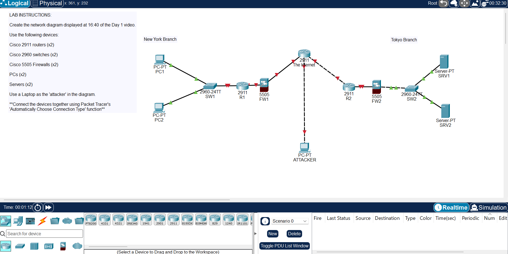
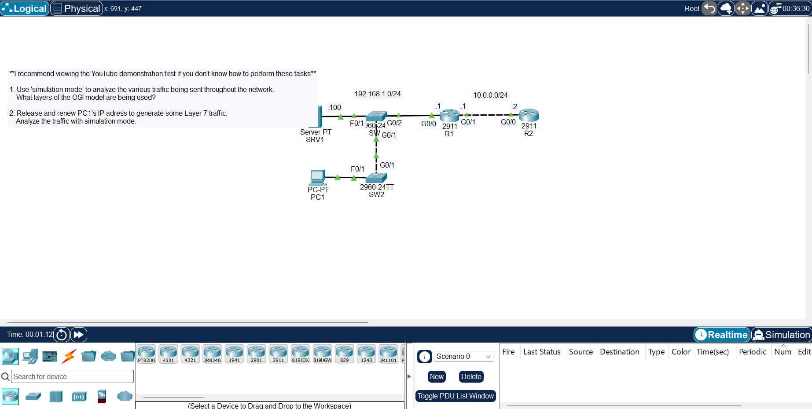
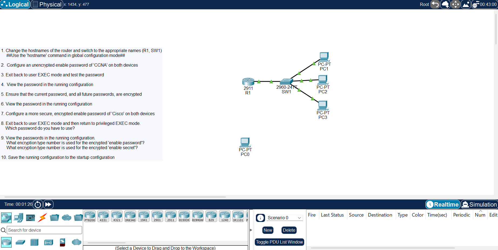

# Cisco CCNA 200-301 Lab Portfolio

Hands-on Cisco Packet Tracer labs I'm completing while studying for the CCNA 200-301 (v2.0) exam. Each lab has its saved Packet Tracer file (`.pkt`), a screenshot of the finished topology, and a short summary of what I configured and why it matters in a real network.

I'm an IT support engineer with 21 months of 2nd line experience on a security-cleared enterprise account (VMware Horizon VDI, Active Directory, ServiceNow). This repository documents the networking side of my skill set as I build it.

## Status

| | |
|---|---|
| Course | Jeremy's IT Lab, CCNA 200-301 complete course |
| Tool | Cisco Packet Tracer 9.0.1 |
| Exam target | CCNA 200-301 (v2.0), March 2027 |
| Labs completed | 4 (Days 1 to 4) |
| Last updated | 5 November 2026 |

## Skills so far

- Identifying network devices and their roles: routers, switches, firewalls, endpoints and servers
- Choosing the right cabling: copper straight-through and crossover, and fibre for long distances
- Tracing traffic through the OSI and TCP/IP models in Packet Tracer simulation mode
- Securing Cisco IOS devices: hostnames, enable secrets, password encryption, saving configurations

## Labs

| Day | Lab | Topic | File |
|---|---|---|---|
| 01 | [Packet Tracer Introduction](#day-01-packet-tracer-introduction) | Network devices and topology | [.pkt](Day%2001%20Lab%20-%20Packet%20Tracer%20Introduction.pkt) |
| 02 | [Connecting Devices](#day-02-connecting-devices) | Cabling and physical layer | [.pkt](Day%2002%20Lab%20-%20Connecting%20Devices.pkt) |
| 03 | [OSI Model](#day-03-osi-model) | Traffic analysis by layer | [.pkt](Day%2003%20Lab%20-%20OSI%20Model.pkt) |
| 04 | [Basic Device Security](#day-04-basic-device-security) | Cisco IOS password security | [.pkt](Day%2004%20Lab%20-%20Basic%20Device%20Security.pkt) |

---

### Day 01: Packet Tracer Introduction

**What I built:** a two-site network (New York and Tokyo branches) linked through an internet router. Each site has a Cisco 2911 router, an ASA 5505 firewall and a Cisco 2960 switch, with PCs at one site, servers at the other, and an attacker host on the internet.

**Skills shown**
- Recognising each device's job: the switch connects local devices, the router links networks, the firewall controls traffic at the edge.
- Building a multi-site topology from a reference design.

**Why it matters:** knowing where each device sits in the path is the starting point for any connectivity ticket, such as working out whether a fault is at the user's switch, the site router or the firewall.

---

### Day 02: Connecting Devices

**What I built:** connected 4 routers, 8 switches, PCs and a server using the correct cable for each link, with Auto MDI-X treated as unavailable so every cable choice had to be right.

**Skills shown**
- Straight-through copper between unlike devices (router to switch, switch to PC) and crossover copper between like devices (switch to switch, router to router).
- Fibre for runs beyond copper's 100 metre limit (the 250 metre and 3 kilometre links), and choosing between single-mode and multimode by distance.

**Why it matters:** wrong cabling is one of the most common causes of a "link down" fault. This is the physical-layer knowledge used for patching, comms room work and data centre cabling.

---

### Day 03: OSI Model

**What I built:** a network with two subnets (192.168.1.0/24 and 10.0.0.0/24) joined by two routers. I used simulation mode to step through traffic packet by packet, and released and renewed PC1's IP address to generate DHCP traffic.

**Skills shown**
- Reading a packet layer by layer, from Ethernet frames (Layer 2) through IP (Layer 3) to the application data (Layer 7).
- Following a DHCP exchange: how a PC asks for and receives its IP address.

**Why it matters:** "no IP address" and "can't reach the server" tickets are solved by finding which layer is failing. This is the method I use to troubleshoot logically rather than guess.

---

### Day 04: Basic Device Security

**What I configured (on router R1 and switch SW1, from the command line):**
- Set hostnames with `hostname`.
- Set an enable password, then tested access from user EXEC mode.
- Encrypted all passwords with `service password-encryption`, and checked the running configuration before and after.
- Replaced it with a hashed `enable secret` and confirmed the secret takes priority over the enable password.
- Saved the running configuration to the startup configuration so it survives a reload.

**Skills shown:** Cisco IOS command line, the difference between weak (type 7) password encryption and a hashed enable secret, and running versus startup configuration.

**Why it matters:** this is the first hardening applied to any new Cisco device. Forgetting to save the configuration is a classic cause of devices losing their settings after a power cut.

---

## About

Khalil Hersi, IT support engineer based in London.
