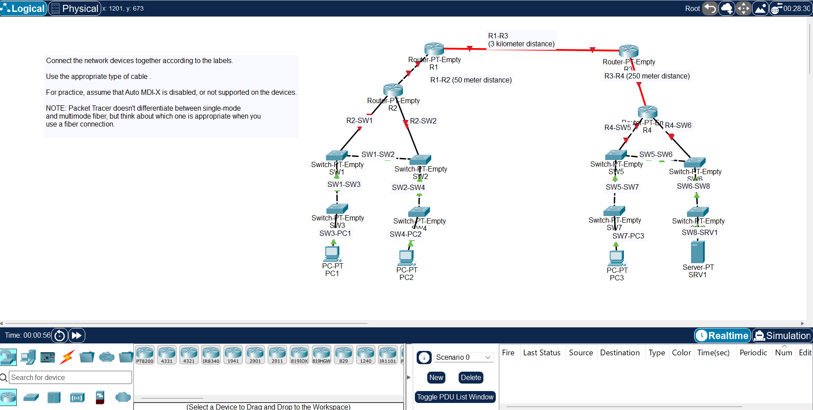

# Cisco CCNA 200-301 Lab Portfolio

Hands-on Cisco Packet Tracer labs I'm completing while studying for the CCNA 200-301 (v2.0) exam. Every completed lab has its own page with the saved Packet Tracer file, a screenshot, what I configured, and why it matters in a real network.

I'm an IT support engineer with 21 months of 2nd line experience on a security-cleared enterprise account (VMware Horizon VDI, Active Directory, ServiceNow). This repository documents the networking side of my skill set as I build it.

## Status

| | |
|---|---|
| Course | Jeremy's IT Lab, CCNA 200-301 complete course |
| Tool | Cisco Packet Tracer 9.0.1 |
| Exam target | CCNA 200-301 (v2.0), March 2027 |
| Progress | 4 of 48 labs completed |
| Last updated | 5 November 2026 |

## Progress by area

| Area | Covers | Completed |
|---|---|---|
| [Fundamentals and device basics](#fundamentals-and-device-basics) | Cabling, the OSI model, IOS basics, IPv4 addressing and subnetting | 4 of 9 |
| [Switching and wireless](#switching-and-wireless) | VLANs, trunking, spanning tree, EtherChannel, CDP/LLDP, wireless | 0 of 12 |
| [Routing](#routing) | Static routes, EIGRP, OSPF, HSRP, GRE tunnels | 0 of 9 |
| [IPv6](#ipv6) | IPv6 addressing and static routing | 0 of 3 |
| [IP services](#ip-services) | NTP, DNS, DHCP, SNMP, Syslog, SSH, FTP/TFTP, NAT, QoS | 0 of 10 |
| [Security](#security) | ACLs, port security, DHCP snooping, dynamic ARP inspection | 0 of 5 |
| **Total** | | **4 of 48** |

## Featured labs

My strongest labs so far. These are replaced as I complete more advanced work.

| [Day 04: Basic Device Security](labs/day-04-basic-device-security.md) | [Day 02: Connecting Devices](labs/day-02-connecting-devices.md) |
|---|---|
|  |  |
| Hardened a Cisco router and switch from the command line: hostnames, hashed enable secret, password encryption, saved configuration. | Cabled 4 routers and 8 switches with the correct copper and fibre for each link and distance, without relying on Auto MDI-X. |

## All labs

### Fundamentals and device basics

| Day | Lab | Status |
|---|---|---|
| 01 | [Packet Tracer Introduction](labs/day-01-packet-tracer-introduction.md) | ✅ Done |
| 02 | [Connecting Devices](labs/day-02-connecting-devices.md) | ✅ Done |
| 03 | [OSI Model](labs/day-03-osi-model.md) | ✅ Done |
| 04 | [Basic Device Security](labs/day-04-basic-device-security.md) | ✅ Done |
| 06 | Ethernet LAN Switching | Planned |
| 08 | IPv4 Addresses | Planned |
| 09 | Interface Configuration | Planned |
| 12 | Life of a Packet | Planned |
| 15 | VLSM | Planned |

### Switching and wireless

| Day | Lab | Status |
|---|---|---|
| 16 | VLANs (Part 1) | Planned |
| 17 | VLANs (Part 2) | Planned |
| 18 | Multilayer Switching | Planned |
| 19 | DTP & VTP | Planned |
| 20 | Analyzing STP | Planned |
| 21 | Configuring Spanning Tree | Planned |
| 22 | Rapid STP | Planned |
| 23 | EtherChannel | Planned |
| 36 | CDP & LLDP | Planned |
| 46 | Voice VLANs | Planned |
| 52 | STP & HSRP Synchronization | Planned |
| 58 | Wireless LANs | Planned |

### Routing

| Day | Lab | Status |
|---|---|---|
| 11 | Configuring Static Routes | Planned |
| 11 | Troubleshooting Static Routes | Planned |
| 24 | Floating Static Routes | Planned |
| 25 | EIGRP Configuration | Planned |
| 26 | OSPF (Part 1) | Planned |
| 27 | OSPF (Part 2) | Planned |
| 28 | OSPF (Part 3) | Planned |
| 29 | HSRP Configuration | Planned |
| 53 | GRE Tunnels | Planned |

### IPv6

| Day | Lab | Status |
|---|---|---|
| 31 | IPv6 Configuration (Part 1) | Planned |
| 32 | IPv6 Configuration (Part 2) | Planned |
| 33 | IPv6 Static Routes | Planned |

### IP services

| Day | Lab | Status |
|---|---|---|
| 37 | NTP | Planned |
| 38 | DNS | Planned |
| 39 | DHCP | Planned |
| 40 | SNMP | Planned |
| 41 | Syslog | Planned |
| 42 | SSH | Planned |
| 43 | FTP & TFTP | Planned |
| 44 | Static NAT | Planned |
| 45 | Dynamic NAT | Planned |
| 47 | QoS | Planned |

### Security

| Day | Lab | Status |
|---|---|---|
| 34 | Standard ACLs | Planned |
| 35 | Extended ACLs | Planned |
| 49 | Port Security | Planned |
| 50 | DHCP Snooping | Planned |
| 51 | Dynamic ARP Inspection | Planned |

### Capstone

| Lab | Status |
|---|---|
| CCNA Mega Lab: a full network built end to end from everything above | Planned |

## About

Khalil Hersi, IT support engineer based in London.
