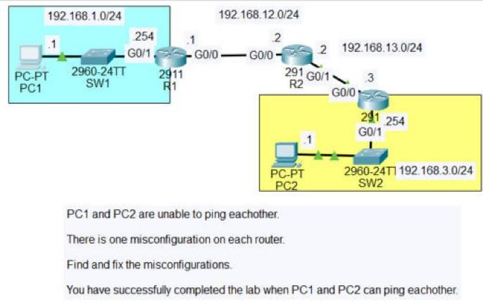
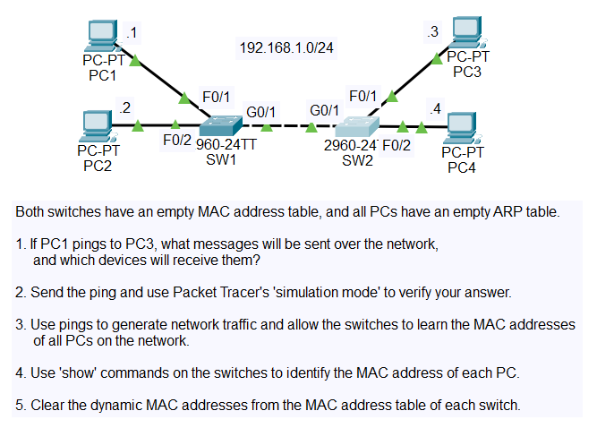

# Cisco CCNA 200-301 Lab Portfolio

Hands-on Cisco Packet Tracer labs I'm completing while studying for the CCNA 200-301 (v1.1) exam. Every completed lab has its own page with the saved Packet Tracer file, a screenshot, what I configured, and why it matters in a real network.

I'm an IT support engineer with 20 months of 2nd line experience on a security-cleared enterprise account (VMware Horizon VDI, Active Directory, ServiceNow). This repository documents the networking side of my skill set as I build it.

## Status

| | |
|---|---|
| Course | Jeremy's IT Lab, CCNA 200-301 complete course |
| Tool | Cisco Packet Tracer 9.0.1 |
| Exam target | CCNA 200-301 (v1.1), 19 January 2027 |
| Progress | 9 of 48 labs completed |
| Last updated | 10 November 2026 |

## Skills so far

<b>👉 Click here to open the skills table</b> (12 skills proven in labs, 1 studied in the course)

✅ = proven in a lab on this page · 📘 = studied in the course, lab still to come

| Skill | What I can do | Evidence |
|---|---|---|
| Network devices and topology | Explain what routers, switches, firewalls, endpoints and servers each do, and build a multi-site topology from a design | ✅ [Packet Tracer Introduction](labs/day-01-packet-tracer-introduction.md) |
| Cabling and interfaces | Choose straight-through, crossover, multimode or single-mode fibre by device type and distance; explain Auto MDI-X | ✅ [Connecting Devices](labs/day-02-connecting-devices.md) |
| OSI and TCP/IP models | Explain encapsulation and the PDU at each layer; read real packets layer by layer in simulation mode | ✅ [OSI Model](labs/day-03-osi-model.md) |
| Cisco IOS command line | Move between user EXEC, privileged EXEC and configuration modes; configure, verify and save with `copy running-config startup-config` | ✅ [Basic Device Security](labs/day-04-basic-device-security.md), [IPv4 Addresses](labs/day-08-ipv4-addresses.md) |
| Device hardening | Use `enable secret` over `enable password`; explain type 7 vs type 5; shut down and label unused ports | ✅ [Basic Device Security](labs/day-04-basic-device-security.md), [Interface Configuration](labs/day-09-interface-configuration.md) |
| Ethernet LAN switching | Explain the Ethernet frame fields (preamble, SFD, MAC addresses, type, FCS), MAC learning, flooding and aging; read and clear `show mac address-table` | ✅ [Ethernet LAN Switching](labs/day-06-ethernet-lan-switching.md) |
| ARP, ICMP and DHCP | Trace ARP requests and replies, ping (echo request and reply) and the DHCP Discover, Offer, Request, Acknowledge exchange packet by packet | ✅ [Ethernet LAN Switching](labs/day-06-ethernet-lan-switching.md), [OSI Model](labs/day-03-osi-model.md) |
| IPv4 addressing | Convert binary; identify class A, B and C networks; work out network, broadcast, first and last usable addresses and max hosts (2ⁿ − 2); address router interfaces and hosts | ✅ [IPv4 Addresses](labs/day-08-ipv4-addresses.md) |
| Switch interfaces | Set speed and duplex, use `interface range`, add descriptions, check with `show interfaces status`; explain duplex mismatches, collision domains and the runt, giant and CRC error counters | ✅ [Interface Configuration](labs/day-09-interface-configuration.md) |
| IPv4 header | Explain the IPv4 header fields, including TTL, the protocol field and fragmentation | 📘 Course (no separate lab for this topic) |
| Routing fundamentals | Read `show ip route`; explain connected (C) and local (L) routes and longest prefix match | ✅ [Configuring Static Routes](labs/day-11-configuring-static-routes.md) |
| Static and default routes | Configure static routes with `ip route` in both directions across a multi-router path; explain exit-interface and default routes (`ip route 0.0.0.0 0.0.0.0`) | ✅ [Configuring Static Routes](labs/day-11-configuring-static-routes.md), [Troubleshooting Static Routes](labs/day-11-troubleshooting-static-routes.md) |
| Troubleshooting routing | Find faults hop by hop with `show ip route` and `show ip interface brief`: wrong next hops, wrong exit interfaces, and routes not installed because the next hop is unreachable; remove bad routes with `no ip route` and retest with ping and `tracert` | ✅ [Troubleshooting Static Routes](labs/day-11-troubleshooting-static-routes.md) |

## Progress by area

| Area | Covers | Completed |
|---|---|---|
| [Core networking and Cisco IOS](#core-networking-and-cisco-ios) | Cabling, the OSI model, IOS basics, IPv4 addressing and subnetting | 7 of 9 |
| [Switching and wireless](#switching-and-wireless) | VLANs, trunking, spanning tree, EtherChannel, CDP/LLDP, wireless | 0 of 12 |
| [Routing](#routing) | Static routes, EIGRP, OSPF, HSRP, GRE tunnels | 2 of 9 |
| [IPv6](#ipv6) | IPv6 addressing and static routing | 0 of 3 |
| [IP services](#ip-services) | NTP, DNS, DHCP, SNMP, Syslog, SSH, FTP/TFTP, NAT, QoS | 0 of 10 |
| [Security](#security) | ACLs, port security, DHCP snooping, dynamic ARP inspection | 0 of 5 |
| **Total** | | **9 of 48** |

## Featured labs

My strongest labs so far. These are replaced as I complete more advanced work.

**Click a lab's title or picture to open the full lab:** every screenshot, the commands used and an explanation of each step.

| [Troubleshooting Static Routes](labs/day-11-troubleshooting-static-routes.md) | [Ethernet LAN Switching](labs/day-06-ethernet-lan-switching.md) |
|---|---|
|  |  |
| Took over a broken three-router network with one fault per router and fixed all three: a wrong next hop, a route out the wrong interface, and a wrong interface IP that stopped a route from installing. Proved it with ping (0% loss) and tracert. | Traced ARP and ping frame by frame across two switches in simulation mode, then read and cleared the MAC address tables to map every PC to its switch port. |

## All labs

**Click any lab name to open the full lab.** Labs marked Planned are still to come.

### Core networking and Cisco IOS

| Day | Lab | Status |
|---|---|---|
| 01 | [Packet Tracer Introduction](labs/day-01-packet-tracer-introduction.md) | ✅ Done |
| 02 | [Connecting Devices](labs/day-02-connecting-devices.md) | ✅ Done |
| 03 | [OSI Model](labs/day-03-osi-model.md) | ✅ Done |
| 04 | [Basic Device Security](labs/day-04-basic-device-security.md) | ✅ Done |
| 06 | [Ethernet LAN Switching](labs/day-06-ethernet-lan-switching.md) | ✅ Done |
| 08 | [IPv4 Addresses](labs/day-08-ipv4-addresses.md) | ✅ Done |
| 09 | [Interface Configuration](labs/day-09-interface-configuration.md) | ✅ Done |
| 12 | Life of a Packet | Planned |
| 15 | VLSM | Planned |

### Switching and wireless

| Day | Lab | Status |
|---|---|---|
| 16 | VLANs (Part 1) | Planned |
| 17 | VLANs (Part 2) | Planned |
| 18 | Multilayer Switching | Planned |
| 19 | DTP & VTP | Planned |
| 20 | Analyzing STP | Planned |
| 21 | Configuring Spanning Tree | Planned |
| 22 | Rapid STP | Planned |
| 23 | EtherChannel | Planned |
| 36 | CDP & LLDP | Planned |
| 46 | Voice VLANs | Planned |
| 52 | STP & HSRP Synchronization | Planned |
| 58 | Wireless LANs | Planned |

### Routing

| Day | Lab | Status |
|---|---|---|
| 11 | [Configuring Static Routes](labs/day-11-configuring-static-routes.md) | ✅ Done |
| 11 | [Troubleshooting Static Routes](labs/day-11-troubleshooting-static-routes.md) | ✅ Done |
| 24 | Floating Static Routes | Planned |
| 25 | EIGRP Configuration | Planned |
| 26 | OSPF (Part 1) | Planned |
| 27 | OSPF (Part 2) | Planned |
| 28 | OSPF (Part 3) | Planned |
| 29 | HSRP Configuration | Planned |
| 53 | GRE Tunnels | Planned |

### IPv6

| Day | Lab | Status |
|---|---|---|
| 31 | IPv6 Configuration (Part 1) | Planned |
| 32 | IPv6 Configuration (Part 2) | Planned |
| 33 | IPv6 Static Routes | Planned |

### IP services

| Day | Lab | Status |
|---|---|---|
| 37 | NTP | Planned |
| 38 | DNS | Planned |
| 39 | DHCP | Planned |
| 40 | SNMP | Planned |
| 41 | Syslog | Planned |
| 42 | SSH | Planned |
| 43 | FTP & TFTP | Planned |
| 44 | Static NAT | Planned |
| 45 | Dynamic NAT | Planned |
| 47 | QoS | Planned |

### Security

| Day | Lab | Status |
|---|---|---|
| 34 | Standard ACLs | Planned |
| 35 | Extended ACLs | Planned |
| 49 | Port Security | Planned |
| 50 | DHCP Snooping | Planned |
| 51 | Dynamic ARP Inspection | Planned |

### Capstone

| Lab | Status |
|---|---|
| CCNA Mega Lab: a full network built end to end from everything above | Planned |

