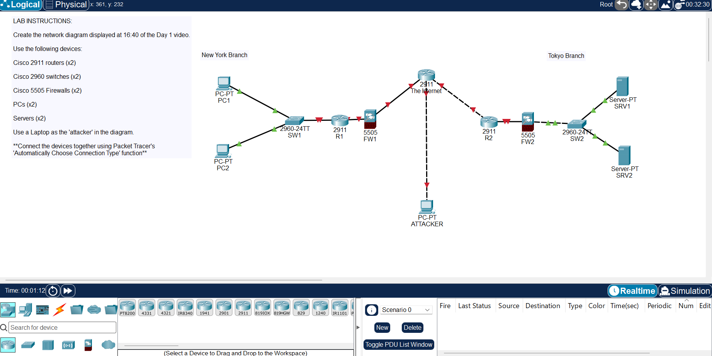

# Packet Tracer Introduction

[Back to all labs](../README.md)

| | |
|---|---|
| Area | Core networking and Cisco IOS |
| Packet Tracer file | [day-01-packet-tracer-introduction.pkt](day-01-packet-tracer-introduction.pkt) |
| Status | Completed |
| Key topics | Device roles, network topology, reading link status lights |

## The task

Rebuild a reference network diagram from scratch in Cisco Packet Tracer, using the right device for each job, and connect it with Packet Tracer's automatic cable selection.

## What I built

Two branch offices, New York and Tokyo, connected through a router standing in for the internet, with an attacker laptop on the internet side.

| Device | Model | Role in this network |
|---|---|---|
| PC1, PC2 | PC | New York users |
| SW1 | Cisco 2960 switch | Connects the New York users into one local network |
| R1 | Cisco 2911 router | New York's gateway to other networks |
| FW1 | Cisco ASA 5505 firewall | Sits between R1 and the internet and controls what gets in and out |
| The Internet | Cisco 2911 router | Represents the public internet joining both sites |
| ATTACKER | PC | An untrusted host on the internet |
| FW2, R2, SW2 | ASA 5505, 2911, 2960 | Tokyo's firewall, router and switch, mirroring New York |
| SRV1, SRV2 | Server | Tokyo's servers |

## Reading the diagram

- **Traffic path.** For PC1 in New York to reach SRV1 in Tokyo, traffic goes PC1 → SW1 → R1 → FW1 → the Internet → FW2 → R2 → SW2 → SRV1. Every device on that path is a place a fault could be.
- **Link lights.** Green triangles mean a link is up, red means it's down. The switch links came up straight away. Every link that touches a router shows red, because Cisco router interfaces are shut down until they're configured, and this lab is only about building the topology. Bringing interfaces up is covered in later labs, such as [IPv4 Addresses](day-08-ipv4-addresses.md).
- **Why the firewalls sit where they do.** Each site's firewall is between its router and the internet, so everything coming from the attacker's side has to pass through it before it reaches the users or servers.

## Skills shown

- **Device roles:** what a switch, a router and a firewall each do, and where each one belongs.
- **Topology building:** turning a reference design into a working Packet Tracer build with the right device models.
- **Reading status at a glance:** using the link lights to see which parts of a network are up.

## Why it matters

Most connectivity tickets start with "where in the path is it failing?". Knowing what each device does, and the order traffic passes through them, is what lets you narrow a fault down to the user's switch, the site router, the firewall or the wider network, instead of guessing.
