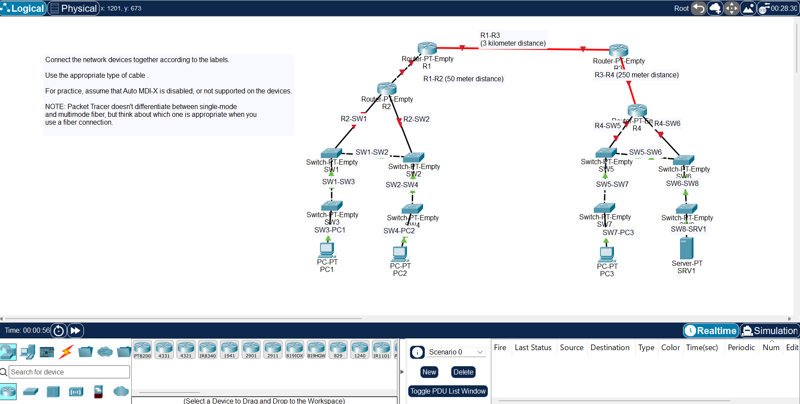

# Day 02: Connecting Devices

[Back to all labs](../README.md)

| | |
|---|---|
| Area | Fundamentals and device basics |
| Packet Tracer file | [day-02-connecting-devices.pkt](day-02-connecting-devices.pkt) |
| Status | Completed |

## What I built

Connected 4 routers, 8 switches, PCs and a server using the correct cable for each link, with Auto MDI-X treated as unavailable so every cable choice had to be right.

## Skills shown

- Straight-through copper between unlike devices (router to switch, switch to PC) and crossover copper between like devices (switch to switch, router to router).
- Fibre for runs beyond copper's 100 metre limit (the 250 metre and 3 kilometre links), and choosing between single-mode and multimode by distance.

## Why it matters

Wrong cabling is one of the most common causes of a "link down" fault. This is the physical-layer knowledge used for patching, comms room work and data centre cabling.
