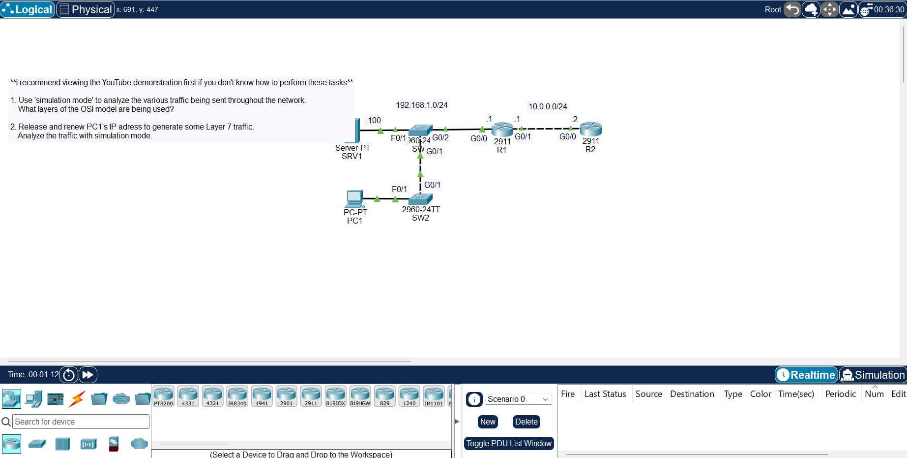

# Day 03: OSI Model

[Back to all labs](../README.md)

| | |
|---|---|
| Area | Fundamentals and device basics |
| Packet Tracer file | [day-03-osi-model.pkt](day-03-osi-model.pkt) |
| Status | Completed |

## What I built

A network with two subnets (192.168.1.0/24 and 10.0.0.0/24) joined by two routers. I used simulation mode to step through traffic packet by packet, and released and renewed PC1's IP address to generate DHCP traffic.

## Skills shown

- Reading a packet layer by layer, from Ethernet frames (Layer 2) through IP (Layer 3) to the application data (Layer 7).
- Following a DHCP exchange: how a PC asks for and receives its IP address.

## Why it matters

"No IP address" and "can't reach the server" tickets are solved by finding which layer is failing. This is the method I use to troubleshoot logically rather than guess.
