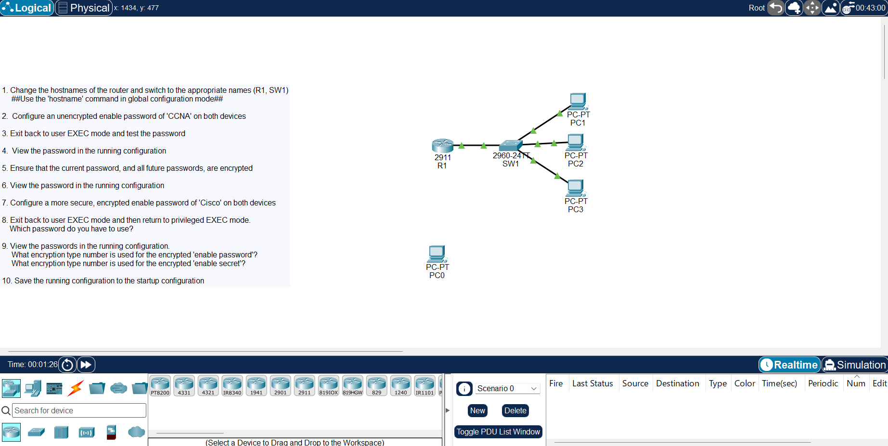

# Basic Device Security

[Back to all labs](../README.md)

| | |
|---|---|
| Area | Core networking and Cisco IOS |
| Packet Tracer file | [day-04-basic-device-security.pkt](day-04-basic-device-security.pkt) |
| Status | Completed |
| Key topics | IOS modes, enable password vs enable secret, password encryption, saving the configuration |



## The task

Secure router R1 and switch SW1 from the command line in ten steps: set the hostnames, add an enable password, encrypt it, replace it with something stronger, and save the result.

## What I configured (on both R1 and SW1)

```
enable
configure terminal
hostname R1                    (SW1 on the switch)
enable password CCNA           step 2: plain-text password
service password-encryption    step 5: encrypt current and future passwords
enable secret Cisco            step 7: stronger, hashed password
end
copy running-config startup-config
```

## Step by step, with the lab questions answered

| Step | What I did and what I saw |
|---|---|
| 1. Hostnames | Named the devices R1 and SW1, so the prompt shows which device you're on |
| 2–3. Enable password | Set `enable password CCNA`, dropped back to user EXEC mode with `exit`, and confirmed `enable` now asks for the password |
| 4. View it | `show running-config` showed the password in plain text: anyone who sees the config can read it |
| 5–6. Encrypt it | `service password-encryption` turned it into a **type 7** string, so it can't be read over someone's shoulder |
| 7. Enable secret | Added `enable secret Cisco`, which is stored as a hashed **type 5** value |
| 8. Which password works? | With both set, only the **enable secret** works. IOS ignores the enable password whenever a secret exists |
| 9. Encryption types | Encrypted enable password: **type 7**. Enable secret: **type 5** |
| 10. Save | `copy running-config startup-config`, so the configuration survives a reload |

## Type 7 vs type 5

Type 7 only hides the password from casual viewing. It's easy to reverse, and free tools decode it in seconds. Type 5 is a one-way hash, which is why the enable secret is the one to use. `service password-encryption` is still worth turning on, because it also hides other passwords in the config, such as console and VTY line passwords.

## Skills shown

- **Cisco IOS modes:** user EXEC (`>`), privileged EXEC (`#`) and global configuration (`(config)#`), and how to move between them.
- **Password security:** the real difference between type 7 and type 5, and why enable secret takes priority.
- **Running vs startup configuration:** changes are live straight away but lost on reload unless they're saved.

## Why it matters

These are the first commands run on any new Cisco device, and the baseline that security audits check for. Forgetting to save is a classic cause of devices losing their settings after a power cut. Knowing that type 7 can be reversed is why you never paste a config with type 7 passwords into a ticket or an email.
