# Ethernet LAN Switching

[Back to all labs](../README.md)

| | |
|---|---|
| Area | Core networking and Cisco IOS |
| Packet Tracer file | [day-06-ethernet-lan-switching.pkt](day-06-ethernet-lan-switching.pkt) |
| Status | Completed |
| Key topics | MAC address learning, flooding, ARP, ICMP, `show mac address-table` |

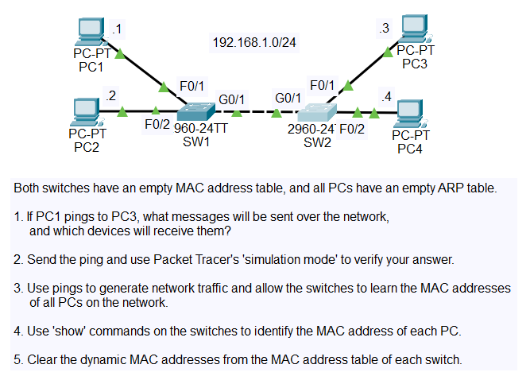

## The scenario

There are four PCs on one subnet (192.168.1.0/24). They are split across two Cisco switches, which are joined by a GigabitEthernet link.

| Device | IP address | MAC address | Connected to |
|---|---|---|---|
| PC1 | 192.168.1.1 | 00d0.d3ad.9cab | SW1 Fa0/1 |
| PC2 | 192.168.1.2 | 0060.5c56.14d3 | SW1 Fa0/2 |
| PC3 | 192.168.1.3 | 0004.9a6e.d870 | SW2 Fa0/1 |
| PC4 | 192.168.1.4 | 0001.647b.3119 | SW2 Fa0/2 |

The lab started with every MAC address table and ARP table empty. The tasks were:

1. Predict which messages a ping from PC1 to PC3 would send, and which devices would receive them.
2. Prove the prediction in simulation mode.
3. Generate traffic so the switches learn every MAC address.
4. Read the MAC tables to identify each PC.
5. Clear the dynamic entries.

The MAC addresses in the table above were not given to me. I worked them out from the switch output shown further down.

---

## 1. Generating traffic from the PCs

<table>
<tr>
<td width="50%">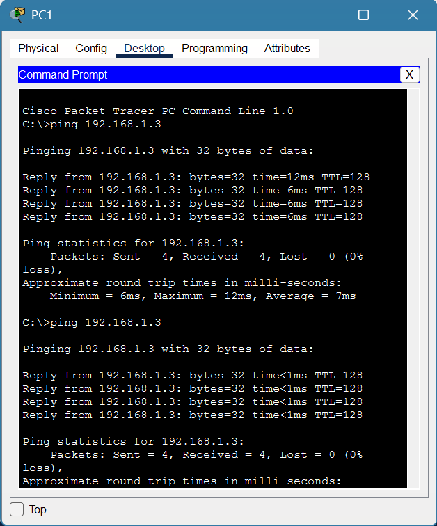</td>
<td width="50%">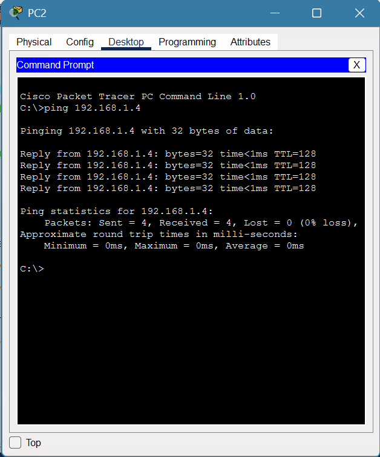</td>
</tr>
<tr>
<td><b>PC1 → PC3 (192.168.1.3)</b> Both ping runs got every reply back with 0% loss. This is the conversation I traced step by step in simulation mode below.</td>
<td><b>PC2 → PC4 (192.168.1.4)</b> All 4 replies were received. This second conversation means all four PCs have sent frames, so both switches can learn every address.</td>
</tr>
</table>

---

## 2. Reading and clearing the MAC address tables

<table>
<tr>
<td width="50%">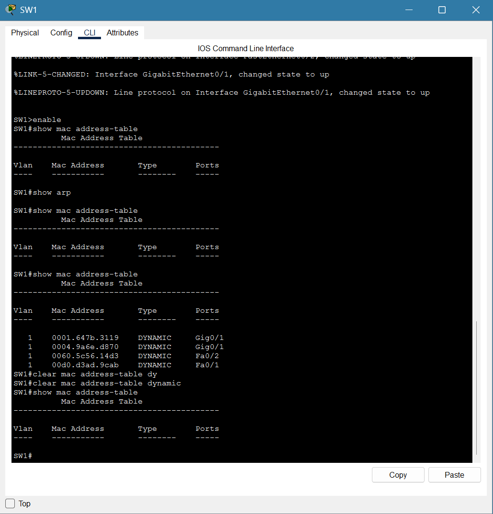</td>
<td width="50%">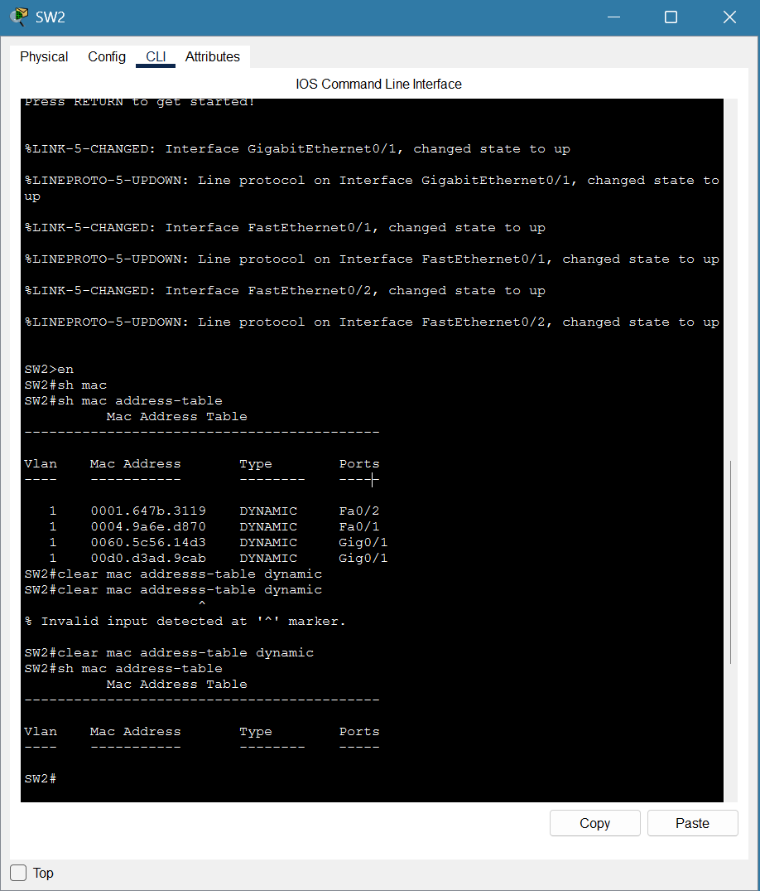</td>
</tr>
<tr>
<td><b>SW1</b> The table was empty at the start. After the pings it holds 4 dynamic entries: PC1 on Fa0/1, PC2 on Fa0/2, and PC3 and PC4 both learned through Gi0/1, the link to SW2. <code>clear mac address-table dynamic</code> then empties the table again.</td>
<td><b>SW2</b> This is the mirror image of SW1: PC3 on Fa0/1, PC4 on Fa0/2, and PC1 and PC2 both learned through Gi0/1. One command was mistyped and IOS rejected it with <code>% Invalid input</code>; I corrected it and carried on. The table was then cleared.</td>
</tr>
</table>

**What this shows:** a switch learns where a device is from the source MAC address of each frame it receives. If several MAC addresses show up on one port, as with Gi0/1 here, that port leads to another switch.

---

## 3. Simulation: the ARP request and reply

PC1 knows PC3's IP address but not its MAC address. Before it can send a ping, it has to find that MAC address using ARP.

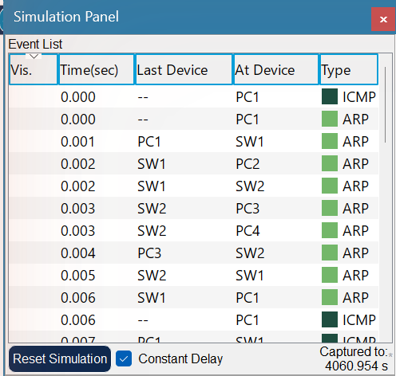

**Event list:** PC1 sends an ARP request to SW1, which floods it to both PC2 and SW2. SW2 then floods it to PC3 and PC4. Only PC3 owns 192.168.1.3, so only PC3 replies. The reply travels PC3 → SW2 → SW1 → PC1.

<table>
<tr>
<td width="50%">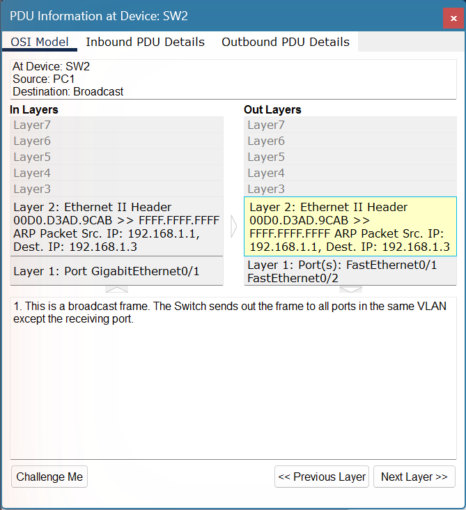</td>
<td width="50%">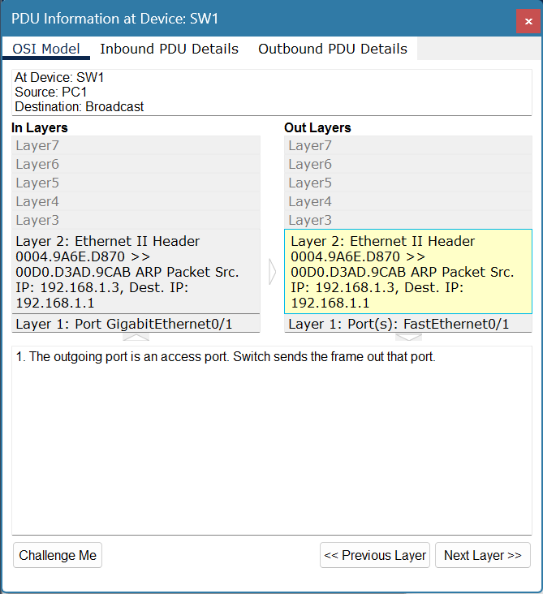</td>
</tr>
<tr>
<td><b>ARP request (broadcast)</b> At SW2, the frame goes from 00D0.D3AD.9CAB (PC1) to <code>FFFF.FFFF.FFFF</code>. It comes in on Gi0/1 and goes out on Fa0/1 and Fa0/2. A broadcast is sent out of every port in the VLAN except the port it arrived on.</td>
<td><b>ARP reply (unicast)</b> At SW1, the frame goes from 0004.9A6E.D870 (PC3) to 00D0.D3AD.9CAB (PC1). It goes out on Fa0/1 only. SW1 already learned PC1's location from the request, so it does not need to flood the reply.</td>
</tr>
</table>

---

## 4. Simulation: the ICMP echo request and reply

Now that PC1 knows PC3's MAC address, the ping itself can be sent.

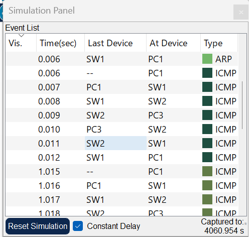

**Event list:** the ICMP packets follow one path, PC1 → SW1 → SW2 → PC3 and back. Neither PC2 nor PC4 receives anything. No ARP happens before the second ping, because PC1 has cached PC3's MAC address.

<table>
<tr>
<td width="50%">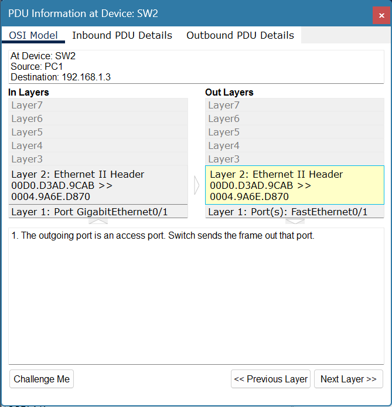</td>
<td width="50%">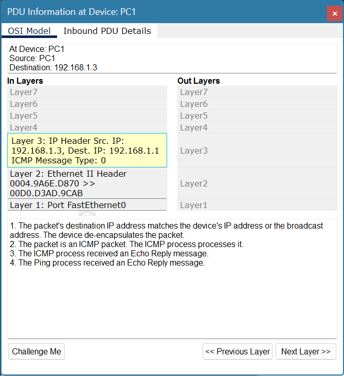</td>
</tr>
<tr>
<td><b>Echo request at SW2</b> The frame goes from 00D0.D3AD.9CAB to 0004.9A6E.D870 and leaves on Fa0/1 only. The destination is a known unicast address, so the switch forwards it out of one port instead of flooding it.</td>
<td><b>Echo reply at PC1</b> At Layer 3 the packet comes from 192.168.1.3 and goes to 192.168.1.1. It is ICMP type 0 (echo reply). Packet Tracer confirms that the Ping process received the Echo Reply.</td>
</tr>
</table>

---

## Expected vs observed

| Expected behaviour (task 1) | What simulation showed |
|---|---|
| PC1 broadcasts an ARP request, and every device on the LAN receives it | ✅ PC2, PC3 and PC4 all received it. Both switches flooded it. |
| Only PC3 replies, and the reply is unicast | ✅ The reply went straight back to PC1 and was never flooded |
| The switches learn PC1 from the request and PC3 from the reply | ✅ The MAC tables matched this |
| The ICMP echo request and reply are unicast between PC1 and PC3 only | ✅ PC2 and PC4 saw no ICMP traffic |

## Skills shown

- **How switches work:** learning addresses from the source MAC, forwarding known unicast frames, and flooding broadcasts and unknown unicast frames.
- **ARP:** why a broadcast request is needed before any IP traffic can flow on a LAN, and how the reply and the ARP cache work.
- **ICMP:** the echo request and echo reply (type 0) behind every `ping`.
- **Cisco IOS:** `show mac address-table` and `clear mac address-table dynamic`.
- **Troubleshooting method:** predicting the traffic first, then checking it frame by frame in Packet Tracer simulation mode with the OSI model view.

## Why it matters

Many "it can't reach the other machine" tickets come down to Layer 2: a device on the wrong port, a stale MAC or ARP entry, or a link between switches that isn't passing traffic. Reading a MAC address table tells you exactly which switch port a device sits behind. That is often the fastest way to trace a PC to a wall socket or a faulty uplink. Knowing what *should* be flooded and what *shouldn't* is also what you need to recognise broadcast storms and to understand why networks are split into VLANs, which comes later in the course.
