# IPv4 Addresses

[Back to all labs](../README.md)

| | |
|---|---|
| Area | Fundamentals and device basics |
| Packet Tracer file | [day-08-ipv4-addresses.pkt](day-08-ipv4-addresses.pkt) |
| Status | Completed |
| Key topics | Class A, B and C networks, router interface addressing, `show ip interface brief`, default gateways |

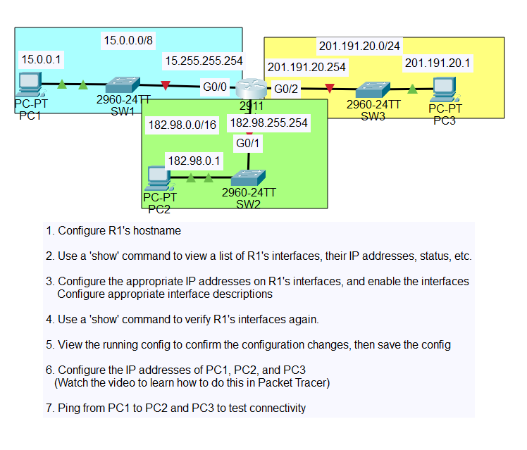

## The scenario

Router R1 joins three separate networks, one of each classful size:

| Network | Class | Mask | R1 interface | R1 address | PC |
|---|---|---|---|---|---|
| 15.0.0.0/8 | A | 255.0.0.0 | G0/0 → SW1 | 15.255.255.254 | PC1 15.0.0.1 |
| 182.98.0.0/16 | B | 255.255.0.0 | G0/1 → SW2 | 182.98.255.254 | PC2 182.98.0.1 |
| 201.191.20.0/24 | C | 255.255.255.0 | G0/2 → SW3 | 201.191.20.254 | PC3 201.191.20.1 |

On every interface R1 takes the last usable address in the network. The PCs take the first usable address.

---

## 1. Hostname and starting point

<table>
<tr>
<td width="50%">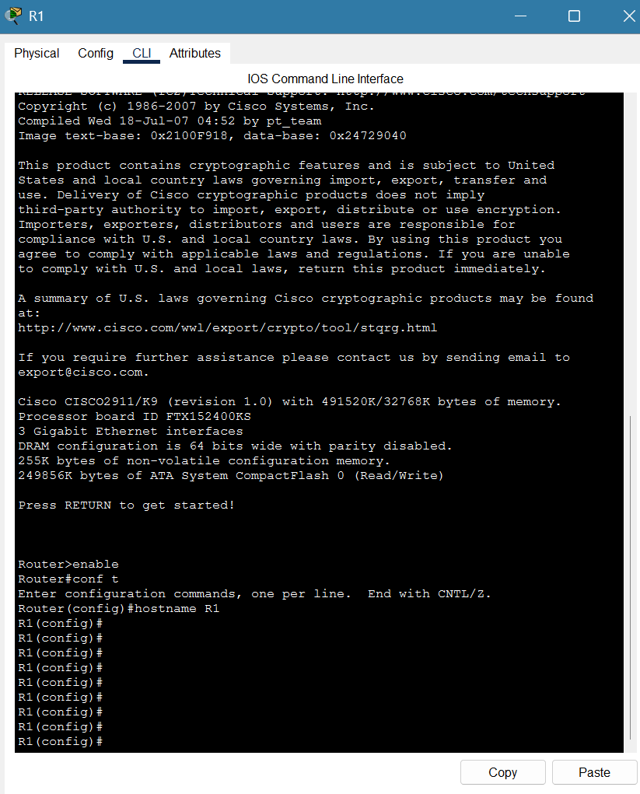</td>
<td width="50%">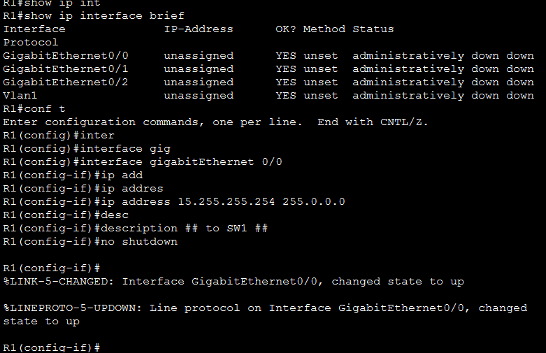</td>
</tr>
<tr>
<td><b>Setting the hostname</b> From a fresh boot I entered privileged EXEC mode, then global configuration mode, and named the router R1.</td>
<td><b>Before and first interface</b> <code>show ip interface brief</code> shows every interface unassigned and <i>administratively down</i>, which is the default on a Cisco router. I then gave G0/0 its address and a description, and brought it up with <code>no shutdown</code>. IOS confirms the link and the line protocol both came up.</td>
</tr>
</table>

## 2. The other two interfaces

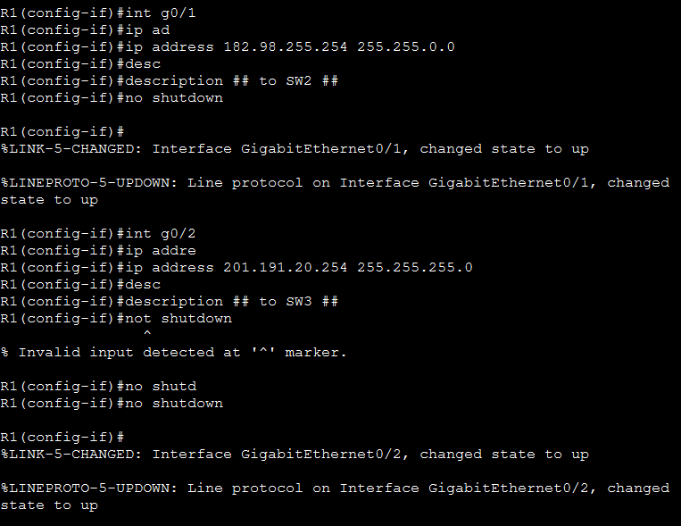

G0/1 got a /16 mask and G0/2 got a /24 mask. I mistyped `not shutdown` on G0/2 and IOS rejected it with `% Invalid input`. I corrected it to `no shutdown` and the interface came up.

## 3. Verifying and saving

<table>
<tr>
<td width="50%">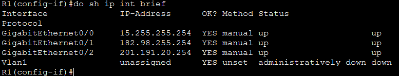</td>
<td width="50%">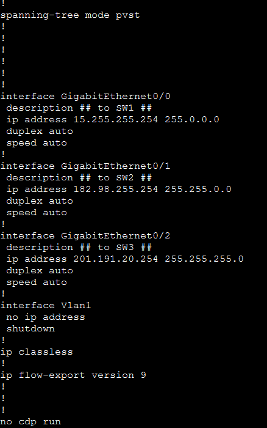</td>
</tr>
<tr>
<td><b>All three interfaces up/up</b> Each one shows its address, <code>manual</code> as the method, and up/up for status and protocol.</td>
<td><b>Running configuration</b> Each interface has its description (<code>## to SW1 ##</code> and so on), its address and its mask.</td>
</tr>
</table>

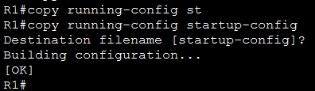

`copy running-config startup-config` saves the configuration so it survives a reload.

---

## 4. Configuring the PCs

<table>
<tr>
<td width="33%">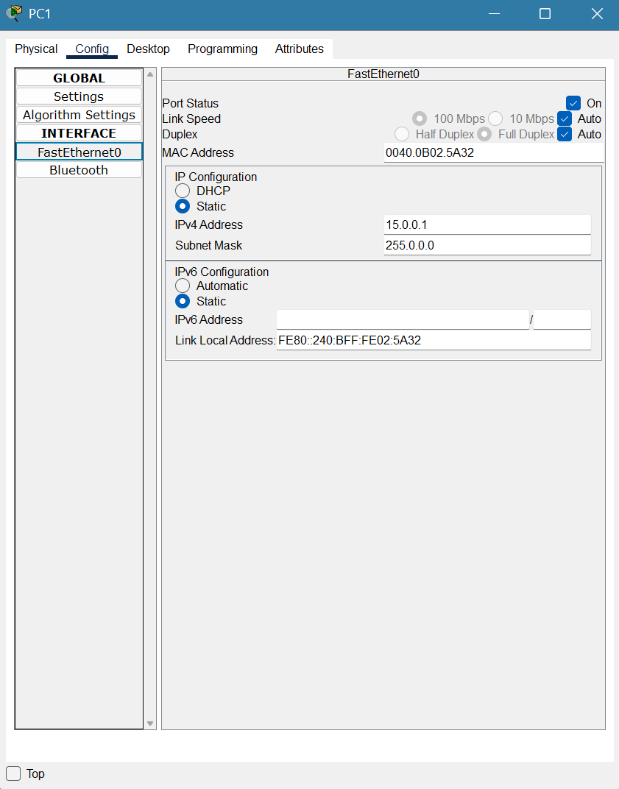</td>
<td width="33%">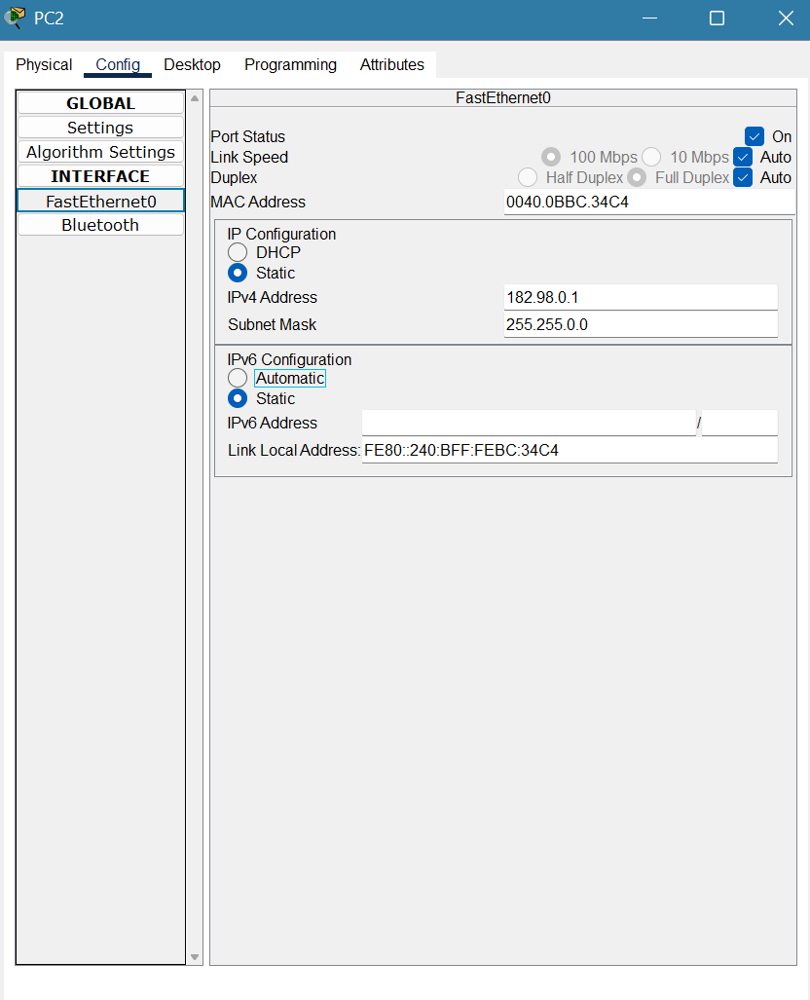</td>
<td width="33%">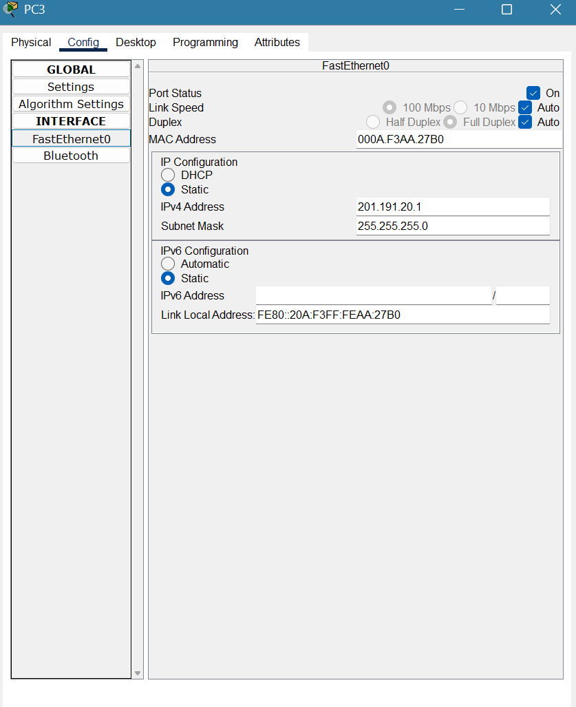</td>
</tr>
<tr>
<td><b>PC1</b> 15.0.0.1 / 255.0.0.0</td>
<td><b>PC2</b> 182.98.0.1 / 255.255.0.0</td>
<td><b>PC3</b> 201.191.20.1 / 255.255.255.0</td>
</tr>
</table>

Each PC uses its R1 interface as its default gateway. That is how a PC reaches anything outside its own network.

## 5. Testing across networks

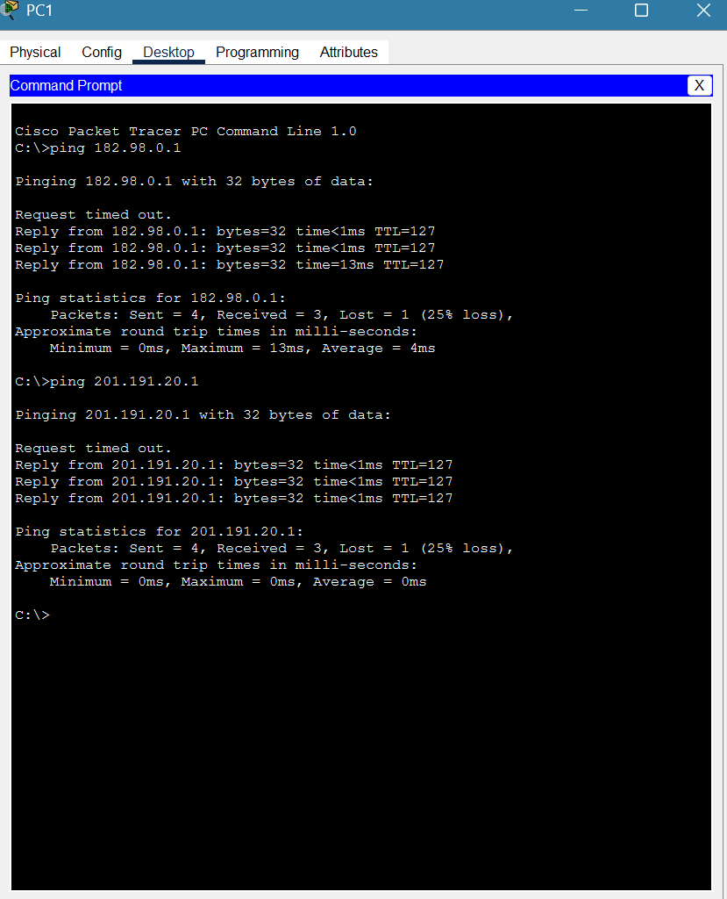

PC1 reached both PC2 and PC3, which are in different networks, through R1.

- **The first ping times out.** That's normal on a brand-new network. PC1 has to ARP for its gateway's MAC address, and R1 has to ARP for the destination's, so the first packet is lost while that happens. After that every reply comes back.
- **TTL=127 rather than 128** proves the packet crossed exactly one router. Each router hop lowers the TTL by 1.

## Skills shown

- **IPv4 addressing:** class A, B and C networks; the network, first usable, last usable and broadcast addresses; how the mask sets the network size.
- **Cisco IOS:** `hostname`, `interface`, `ip address`, `description`, `no shutdown`, `show ip interface brief`, `show running-config`, `copy running-config startup-config`.
- **Routing basics:** a router keeps networks apart and forwards between them, and each host needs a default gateway to leave its own network.
- **Reading the output:** the first lost ping explained by ARP, and the TTL showing how many hops a packet took.

## Why it matters

Giving interfaces the right address and mask is the first step in every network build, and a wrong mask or gateway is one of the most common reasons a user "can see some things but not others". Reading `show ip interface brief` at a glance is also how you check a router during any fault call: it shows straight away whether an interface is shut down, unaddressed or physically down.
