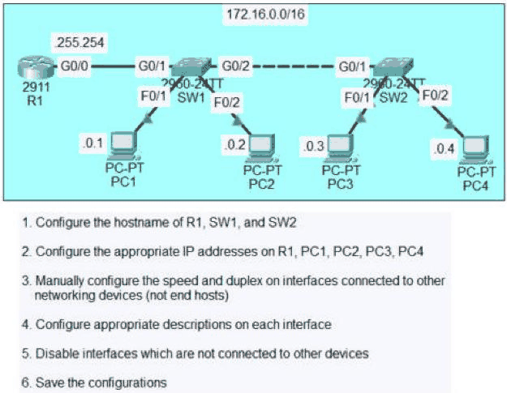
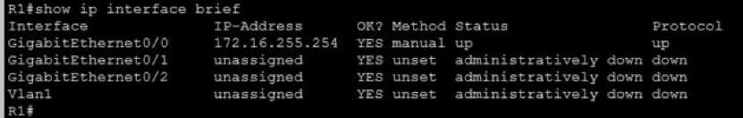
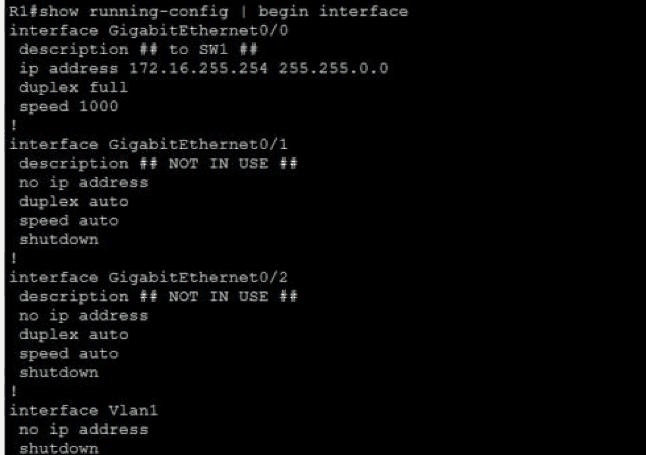
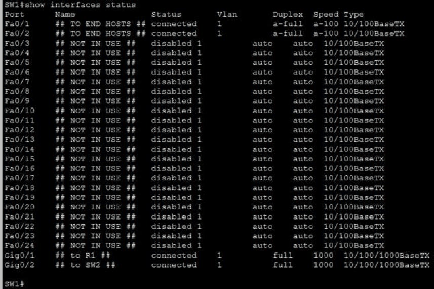
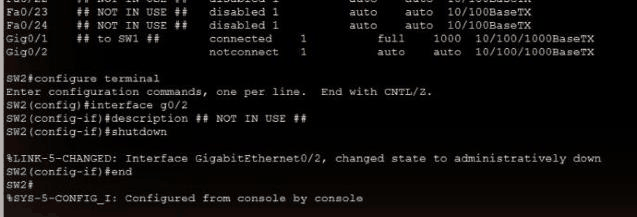
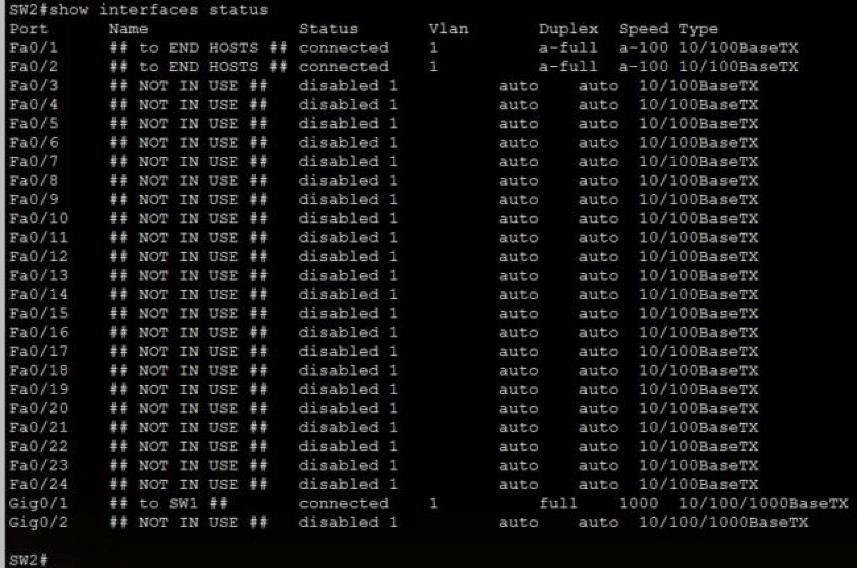
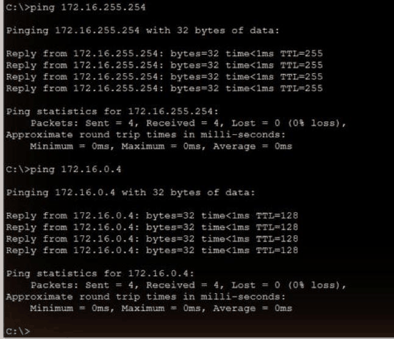

# Interface Configuration

[Back to all labs](../README.md)

| | |
|---|---|
| Area | Fundamentals and device basics |
| Packet Tracer file | [day-09-interface-configuration.pkt](day-09-interface-configuration.pkt) |
| Status | Completed |
| Key topics | Speed and duplex, interface descriptions, shutting down unused ports, `show interfaces status` |

## The scenario

There is one /16 network (172.16.0.0/16). R1 is the gateway at 172.16.255.254, and SW1 and SW2 connect four PCs (.1 to .4). The tasks were:

1. Set the hostnames on R1, SW1 and SW2.
2. Address R1 and the four PCs.
3. Manually set speed and duplex on links between network devices, but not on links to end hosts.
4. Add a description to every interface.
5. Shut down every interface that isn't connected to anything.
6. Save the configurations.

---

## 1. R1

<table>
<tr>
<td width="50%"></td>
<td width="50%"></td>
</tr>
<tr>
<td><b>Interface summary</b> Only G0/0, the link to SW1, is up, with 172.16.255.254. G0/1 and G0/2 are unused, so they're <i>administratively down</i>, exactly as task 5 asks.</td>
<td><b>Interface configuration</b> G0/0 is set to <code>speed 1000</code> and <code>duplex full</code>, with the description <code>## to SW1 ##</code>. The unused ports are labelled <code>## NOT IN USE ##</code> and shut down.</td>
</tr>
</table>

## 2. SW1

`show interfaces status` proves tasks 3, 4 and 5 in one screen:

- **Fa0/1 and Fa0/2** connect to the PCs. They're labelled `## TO END HOSTS ##` and left on auto. They show `a-full` and `a-100`: full duplex at 100 Mbps, both negotiated automatically.
- **Gi0/1 (to R1) and Gi0/2 (to SW2)** are links between network devices. They're hard-set to `full` and `1000`, so there's no `a-` prefix.
- **Fa0/3 to Fa0/24** are unused. Every one is labelled `## NOT IN USE ##` and shows `disabled`.

## 3. SW2, including a fix I caught on review

<table>
<tr>
<td width="50%"></td>
<td width="50%"></td>
</tr>
<tr>
<td><b>The miss</b> When I went back over the saved lab, SW2's Gi0/2 had no description and showed <code>notconnect</code>, not <code>disabled</code>. It was unused but still enabled. I added <code>## NOT IN USE ##</code>, shut it down and saved with <code>copy running-config startup-config</code>.</td>
<td><b>After the fix</b> Gi0/1 to SW1 runs at full/1000, the PC ports negotiate automatically, and every unused port, Gi0/2 included, now shows <code>disabled</code>.</td>
</tr>
</table>

## 4. End-to-end test

PC1 reached R1 (172.16.255.254) and PC4 (172.16.0.4), which is behind the second switch, with 0% loss. Forcing the speed and duplex didn't break any link.

## Skills shown

- **Speed and duplex:** setting them by hand on links between network devices and leaving autonegotiation on for end hosts. Reading `a-full` / `a-100` (negotiated) against `full` / `1000` (set by hand).
- **Interface hygiene:** a consistent description scheme, and every unused port shut down so nothing can be plugged in and used without anyone noticing.
- **Verification:** `show interfaces status` and `show ip interface brief` to check a whole switch or router in one screen.
- **Reviewing my own work:** I found an unused port that had been missed and fixed it, instead of assuming the lab was complete.

## Why it matters

A duplex mismatch is a classic cause of a link that's "up but slow", with late collisions and errors showing in the interface counters. Being able to spot one from `show interfaces status` is a day-to-day support skill. Clear descriptions save time on every fault call, because you can see what a port connects to without tracing cables. Shutting down unused ports is a basic security baseline, and it's the starting point for port security later in the course.
