# Configuring Static Routes

[Back to all labs](../README.md)

| | |
|---|---|
| Area | Routing |
| Packet Tracer file | [day-11-configuring-static-routes.pkt](day-11-configuring-static-routes.pkt) |
| Status | Completed |
| Key topics | Static routes, next hop, routing tables, default gateways, `show ip route`, `tracert` |

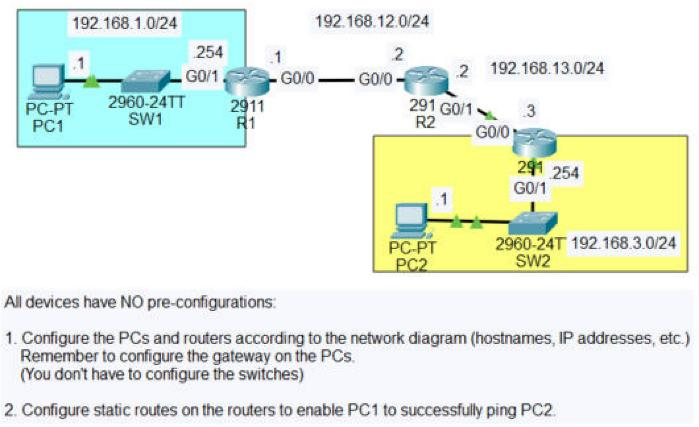

## The scenario

Two LANs sit on either side of three routers, and none of the devices was configured at the start.

| Network | Devices |
|---|---|
| 192.168.1.0/24 | PC1 (.1), SW1, R1 G0/1 (.254) |
| 192.168.12.0/24 | R1 G0/0 (.1) to R2 G0/0 (.2) |
| 192.168.13.0/24 | R2 G0/1 (.2) to R3 G0/0 (.3) |
| 192.168.3.0/24 | PC2 (.1), SW2, R3 G0/1 (.254) |

The tasks were:

1. Configure the PCs and routers from the diagram: hostnames, IP addresses, and the default gateway on each PC.
2. Configure static routes on the routers so PC1 can ping PC2.

A router only knows the networks it's directly connected to. R1 has never heard of 192.168.3.0/24 and R3 has never heard of 192.168.1.0/24, so every router on the path needs routes in **both** directions: there for the request, and back for the reply.

---

## 1. R1

<table>
<tr>
<td width="50%">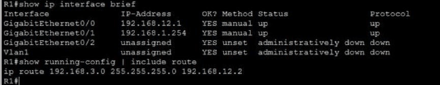</td>
<td width="50%">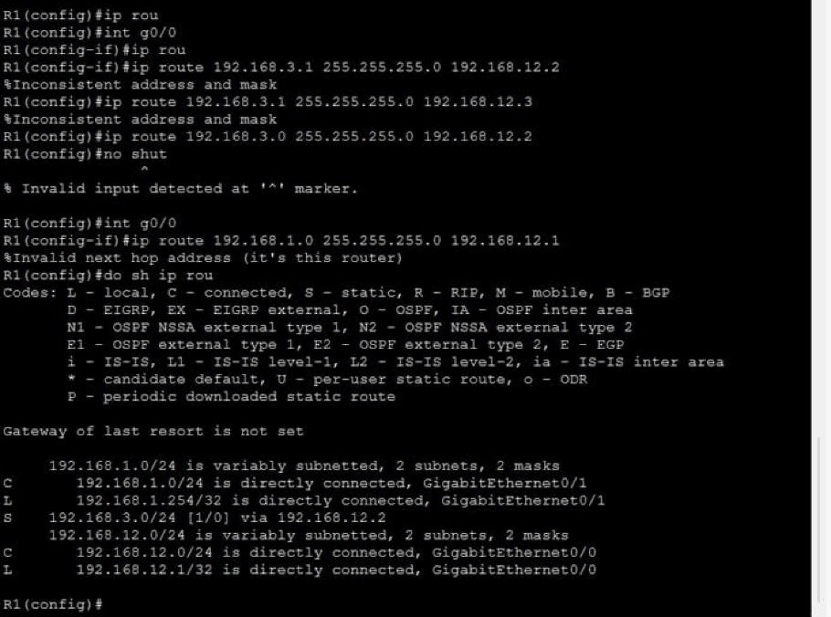</td>
</tr>
<tr>
<td><b>Interfaces and route</b><br>G0/0 (192.168.12.1, towards R2) and G0/1 (192.168.1.254, PC1's gateway) are up/up, and the unused G0/2 stays shut. <code>show running-config | include route</code> shows the one static route R1 needs: <code>ip route 192.168.3.0 255.255.255.0 192.168.12.2</code>.</td>
<td><b>Getting there, and the routing table</b><br>The table shows the new <b>S</b> (static) route next to R1's own <b>C</b> and <b>L</b> routes. It also shows two mistakes I made on the way:<br>• <code>%Inconsistent address and mask</code>: I used 192.168.3.1, a host address, instead of the network address 192.168.3.0.<br>• <code>%Invalid next hop address (it's this router)</code>: the next hop has to be the <i>neighbouring</i> router, not one of R1's own addresses.</td>
</tr>
</table>

## 2. R2: the router in the middle

<table>
<tr>
<td width="50%">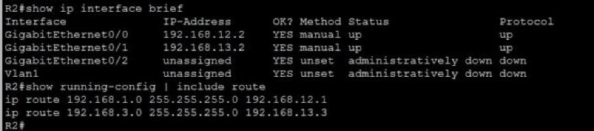</td>
<td width="50%">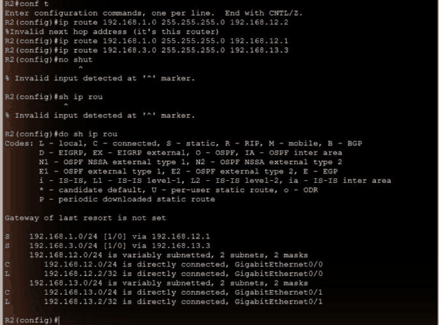</td>
</tr>
<tr>
<td><b>Interfaces and routes</b><br>G0/0 (192.168.12.2) towards R1 and G0/1 (192.168.13.2) towards R3 are up/up. R2 is connected to neither LAN, so it needs <b>two</b> static routes, one in each direction.</td>
<td><b>Routing table</b><br><code>S 192.168.1.0/24 via 192.168.12.1</code> and <code>S 192.168.3.0/24 via 192.168.13.3</code>. Here I first tried R2's own address as the next hop, got the same "it's this router" error, and corrected it.</td>
</tr>
</table>

## 3. R3: built from scratch, plus the return route

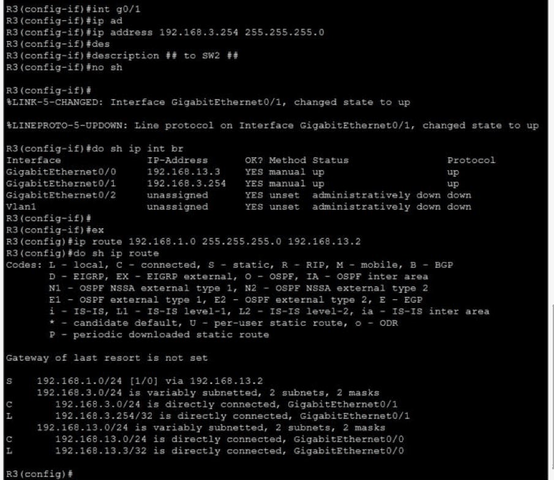

This shows R3's G0/1 being configured (192.168.3.254, description `## to SW2 ##`, `no shutdown`), checked with `show ip interface brief`, and then the **return route** to PC1's network:

```
ip route 192.168.1.0 255.255.255.0 192.168.13.2
```

Without it, PC1's pings would reach PC2, but PC2's replies would have nowhere to go.

---

## 4. The PCs: addresses and default gateways

<table>
<tr>
<td width="50%">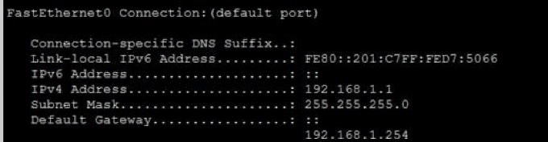</td>
<td width="50%">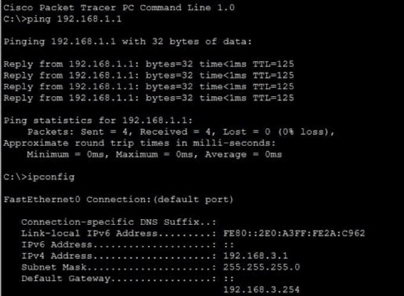</td>
</tr>
<tr>
<td><b>PC1</b><br>192.168.1.1/24, default gateway <b>192.168.1.254</b> (R1). The gateway is how PC1 sends anything outside its own network.</td>
<td><b>PC2</b><br>192.168.3.1/24, default gateway <b>192.168.3.254</b> (R3). It's also tested in the other direction: PC2 pings PC1 with 4 of 4 replies.</td>
</tr>
</table>

## 5. Proving the path

<table>
<tr>
<td width="50%">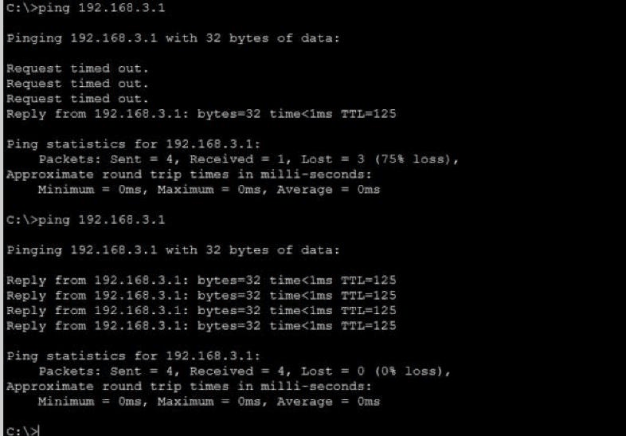</td>
<td width="50%">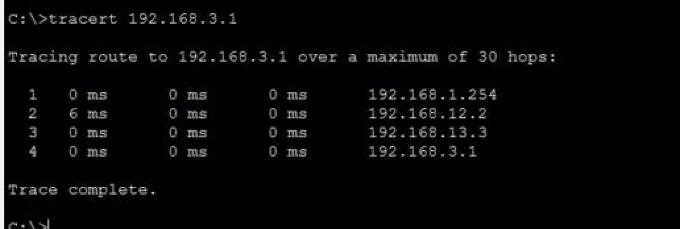</td>
</tr>
<tr>
<td><b>Ping PC1 → PC2</b><br>The first run lost 3 of 4 while ARP resolved the MAC address at each link (PC1 to R1, R1 to R2, R2 to R3, R3 to PC2). The second run got 4 of 4. <b>TTL=125</b> means 128 minus one for each of the three routers.</td>
<td><b><code>tracert</code> PC1 → PC2</b><br>Shows every hop the packet takes: <b>192.168.1.254</b> (R1) → <b>192.168.12.2</b> (R2) → <b>192.168.13.3</b> (R3) → <b>192.168.3.1</b> (PC2). This proves the static routes send traffic along exactly the planned path.</td>
</tr>
</table>

---

## 6. Extra: shutting down unused switch ports

<table>
<tr>
<td width="50%">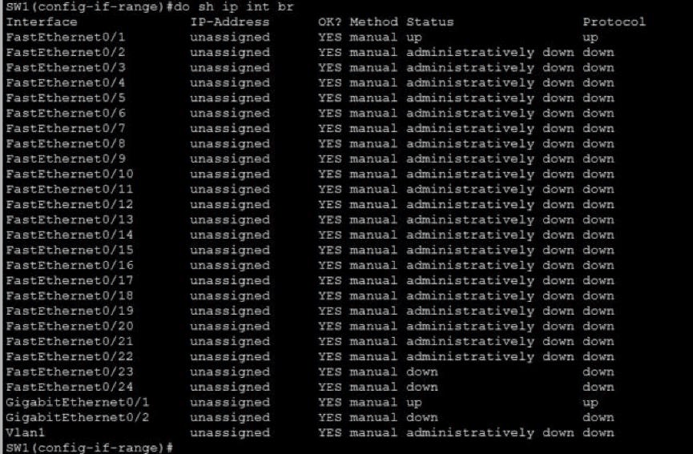</td>
<td width="50%">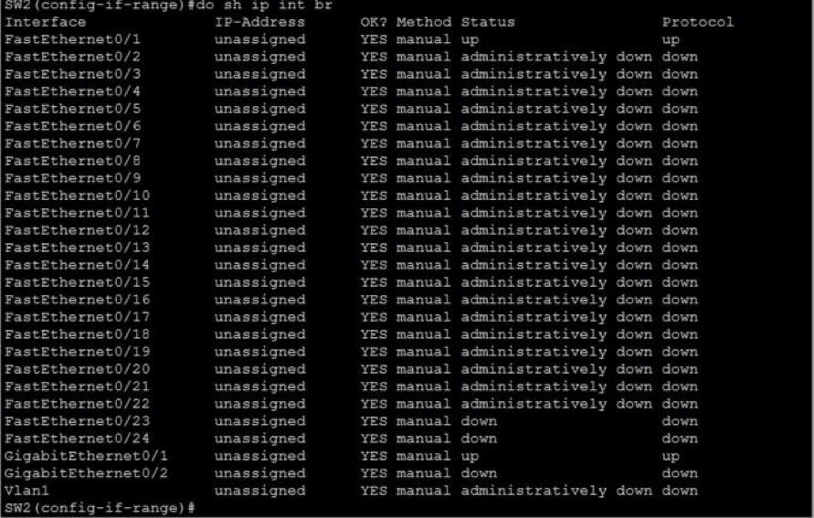</td>
</tr>
<tr>
<td><b>SW1</b><br>Fa0/1 (to PC1) and Gi0/1 (to R1) up; Fa0/2 to Fa0/22 <i>administratively down</i>.</td>
<td><b>SW2</b><br>Same on the other side: Fa0/1 (to PC2) and Gi0/1 (to R3) up; Fa0/2 to Fa0/22 <i>administratively down</i>.</td>
</tr>
</table>

The lab didn't ask for any switch configuration. I used `interface range` to shut down unused ports on both switches as good practice.

## Skills shown

- **Static routing:** `ip route <network> <mask> <next hop>`, with routes in both directions on every router in the path.
- **Reading the routing table:** telling static (S), connected (C) and local (L) routes apart in `show ip route`.
- **Router and host addressing:** interfaces, descriptions, `no shutdown`, and default gateways on the PCs.
- **Learning from IOS errors:** understanding why "inconsistent address and mask" and "invalid next hop" appeared, and fixing the commands.
- **Verification from both ends:** pings in both directions, `tracert` to prove the path hop by hop, and `show running-config | include route` to audit the configuration.

## Why it matters

"Site A can't reach site B" is one of the most common network tickets, and a missing or wrong route, very often the *return* route, is a classic cause. Checking `show ip route` on each router in both directions, and using `tracert` to see exactly where traffic stops, is how that kind of fault gets tracked down. Static routes are also still used in real networks for small sites, default routes to the internet, and backup paths.
