# Troubleshooting Static Routes

[Back to all labs](../README.md)

| | |
|---|---|
| Area | Routing |
| Packet Tracer file | [day-11-troubleshooting-static-routes.pkt](day-11-troubleshooting-static-routes.pkt) |
| Status | Completed |
| Key topics | Troubleshooting method, `show ip route`, `show ip interface brief`, next hop vs exit interface, interface addressing |

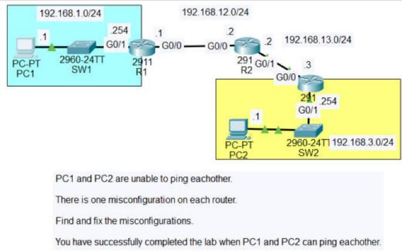

## The scenario

This is the same three-router network as [Configuring Static Routes](day-11-configuring-static-routes.md), but handed over already broken. PC1 (192.168.1.1) and PC2 (192.168.3.1) can't ping each other, and **each router has one misconfiguration**. The job is to find and fix all three.

| Router | Fault I found | Symptom in the CLI | Fix |
|---|---|---|---|
| R1 | Static route to 192.168.3.0/24 pointed at the wrong next hop, **192.168.12.3** | `S 192.168.3.0/24 via 192.168.12.3`, an address that doesn't exist (R2 is .2) | Removed it, re-added `via 192.168.12.2` |
| R2 | Route to 192.168.3.0/24 sent out the **wrong exit interface, G0/0**, back towards R1 | `S 192.168.3.0/24 is directly connected, GigabitEthernet0/0` | Removed it, added `via 192.168.13.3` |
| R3 | **G0/0 had the wrong IP address**, 192.168.23.3 instead of 192.168.13.3 | `show ip interface brief` showed 192.168.23.3, and the route back to 192.168.1.0/24 never appeared in the routing table | Changed G0/0 to 192.168.13.3/24 |

---

## 1. R1: wrong next hop

<table>
<tr>
<td width="50%">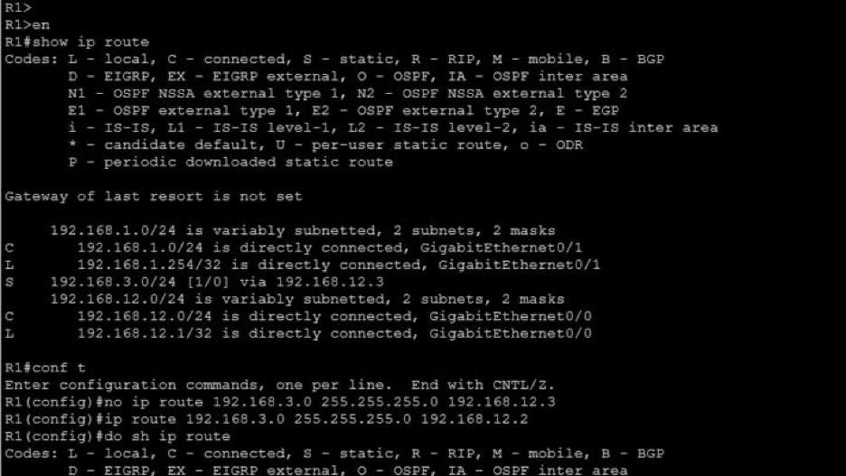</td>
<td width="50%">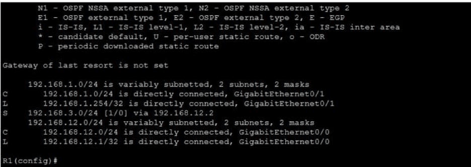</td>
</tr>
<tr>
<td><b>Found</b> <code>show ip route</code> showed <code>S 192.168.3.0/24 via 192.168.12.3</code>. On the 192.168.12.0/24 link R1 is .1 and R2 is .2, so .3 is nobody: R1 was sending PC2's traffic to an address that doesn't exist.</td>
<td><b>Fixed</b> <code>no ip route 192.168.3.0 255.255.255.0 192.168.12.3</code>, then <code>ip route 192.168.3.0 255.255.255.0 192.168.12.2</code>. The routing table now shows <code>via 192.168.12.2</code>, which is R2.</td>
</tr>
</table>

## 2. R2: wrong exit interface

R2's route to PC2's network was configured with an **exit interface** instead of a next hop, and it was the wrong one: G0/0 faces R1, not R3. These four screenshots are R2's whole session in order. I tried a few approaches before getting a clean result.

<table>
<tr>
<td width="50%">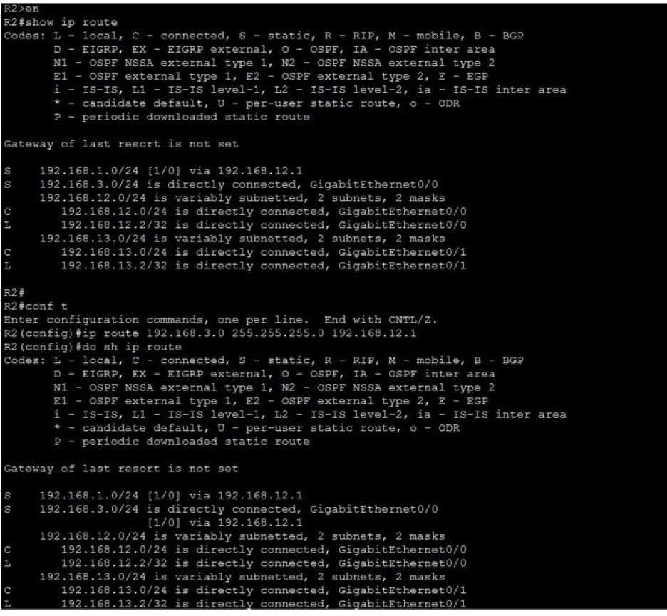</td>
<td width="50%">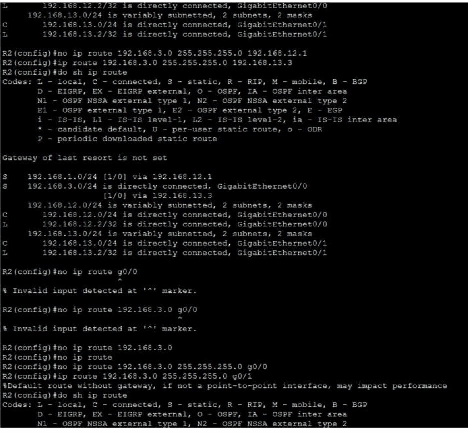</td>
</tr>
<tr>
<td><b>1. Found it</b> The table showed <code>S 192.168.3.0/24 is directly connected, GigabitEthernet0/0</code>. My first attempt, <code>via 192.168.12.1</code>, was wrong too, because that points back at R1.</td>
<td><b>2. Correcting it</b> I removed the 12.1 route and added the correct one, <code>via 192.168.13.3</code> (R3). Then I worked out the right syntax to delete the bad exit-interface route: <code>no ip route 192.168.3.0 255.255.255.0 g0/0</code>.</td>
</tr>
<tr>
<td width="50%">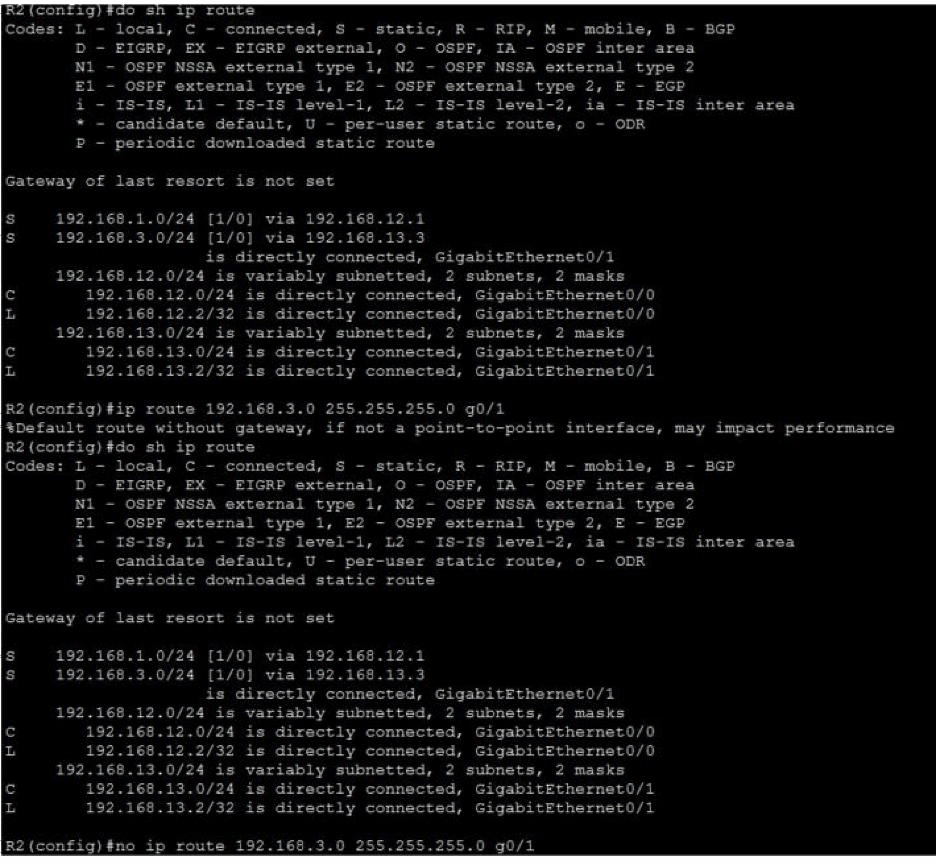</td>
<td width="50%">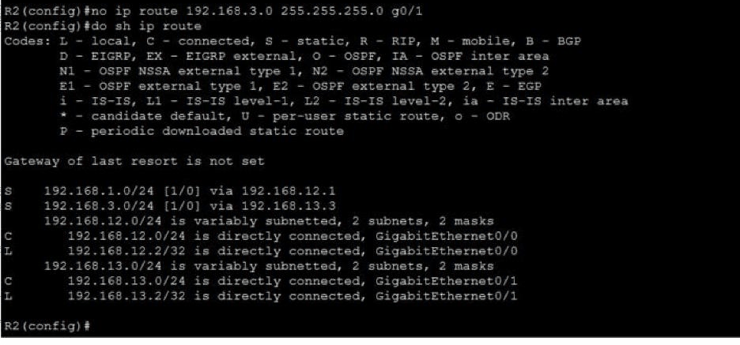</td>
</tr>
<tr>
<td><b>3. Testing the alternative</b> I also tried an exit-interface route out the correct interface (<code>g0/1</code>). IOS warned: <i>"Default route without gateway, if not a point-to-point interface, may impact performance"</i>. On Ethernet, a route with only an exit interface makes the router ARP for every destination.</td>
<td><b>4. Final state</b> I removed the G0/1 version and kept the cleaner next-hop route. R2 ends with <code>S 192.168.1.0/24 via 192.168.12.1</code> and <code>S 192.168.3.0/24 via 192.168.13.3</code>.</td>
</tr>
</table>

## 3. R3: wrong interface IP (the final fix)

<table>
<tr>
<td width="50%">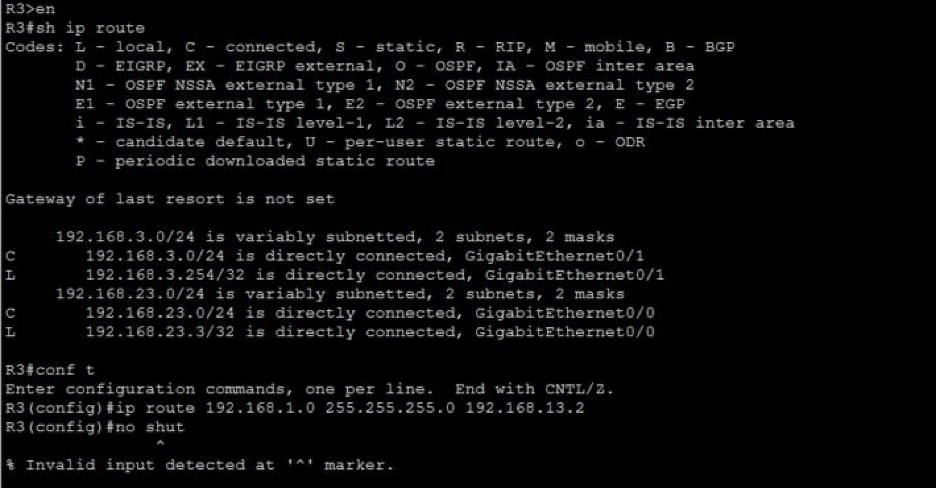</td>
<td width="50%">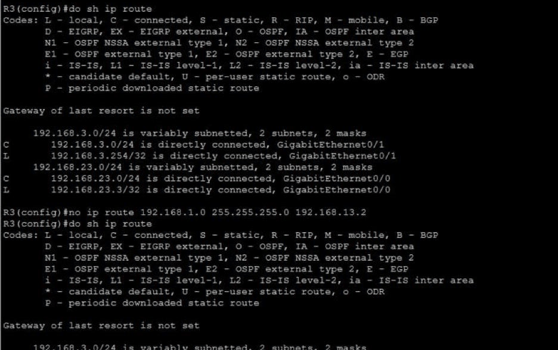</td>
</tr>
<tr>
<td><b>1. The clue</b> R3's table showed a connected network of <b>192.168.23.0/24</b> on G0/0. That network doesn't exist anywhere in the diagram, where the link to R2 is 192.168.13.0/24. There was also no route back to 192.168.1.0/24.</td>
<td><b>2. The route wouldn't appear</b> I entered <code>ip route 192.168.1.0 255.255.255.0 192.168.13.2</code>. IOS accepted it, but <code>show ip route</code> still had no S route. A static route is only installed when its next hop is reachable, and R3 had no interface on 192.168.13.0/24.</td>
</tr>
<tr>
<td width="50%">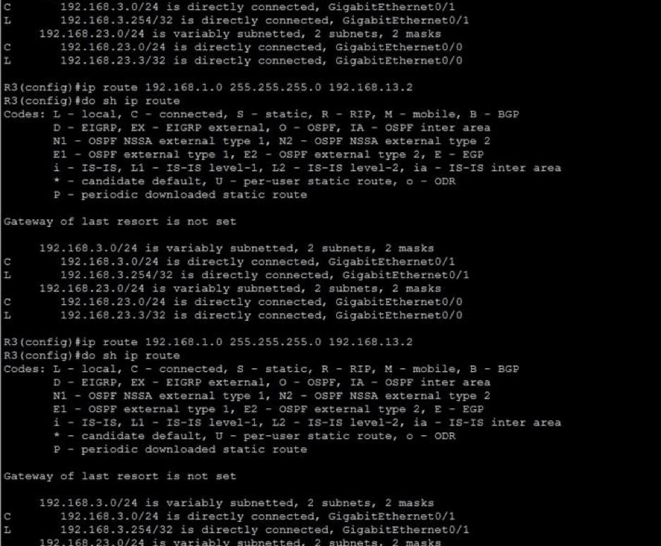</td>
<td width="50%">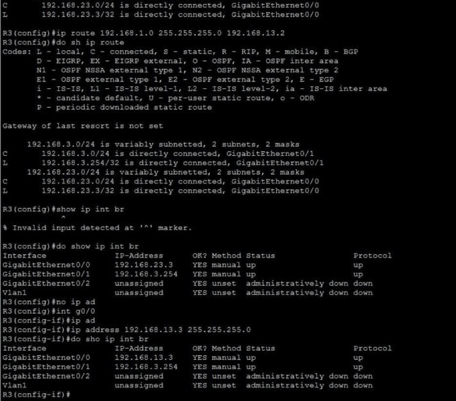</td>
</tr>
<tr>
<td><b>3. Ruling out the route</b> Re-entering the route made no difference, so the problem had to be below it.</td>
<td><b>4. Root cause</b> <code>show ip interface brief</code> confirmed G0/0 was <b>192.168.23.3</b>. I changed it with <code>ip address 192.168.13.3 255.255.255.0</code>, and the interface summary then showed 192.168.13.3.</td>
</tr>
</table>

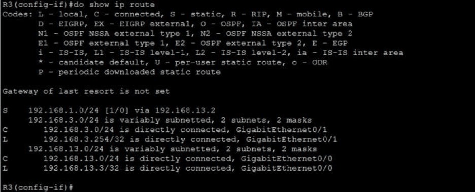

**After the fix:** with G0/0 on the right network, R3's next hop 192.168.13.2 became reachable, and the static route finally appeared: `S 192.168.1.0/24 via 192.168.13.2`. One wrong interface address had been silently disabling a correctly typed route.

---

## 4. PC1: testing after every change

I pinged PC2 from PC1 after each fix to see whether it had worked.

<table>
<tr>
<td width="33%">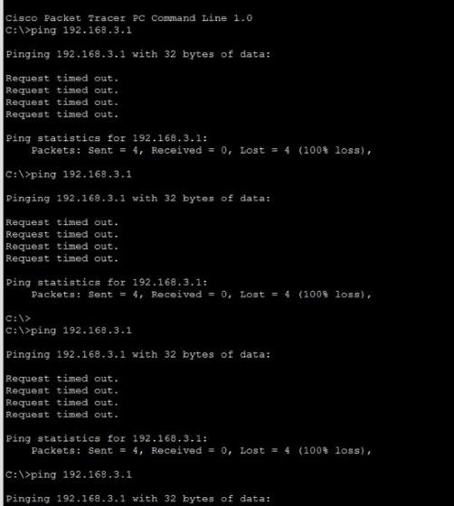</td>
<td width="33%">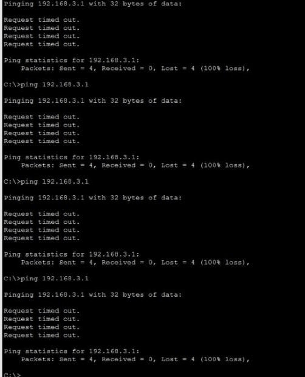</td>
<td width="33%">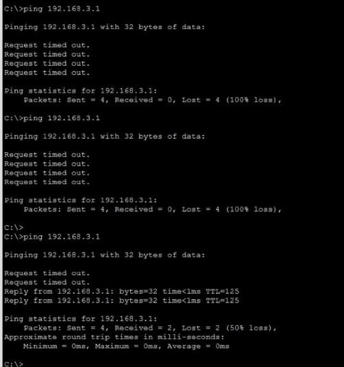</td>
</tr>
<tr>
<td>Pings 1 to 3: 100% loss.</td>
<td>Pings 4 to 7: still 100% loss. Each fix was needed, but none worked alone while another router was still broken.</td>
<td>Pings 8 and 9: 100% loss. After the R3 fix, the first replies came back (2 of 4, while ARP ran) at <b>TTL=125</b>.</td>
</tr>
</table>

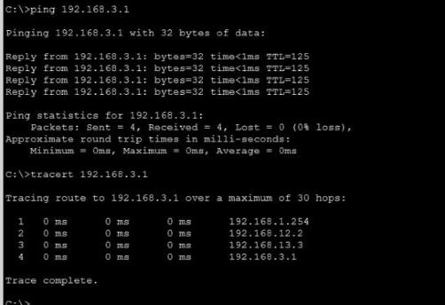

**Final test:** 4 of 4 replies (0% loss), and `tracert` shows the full path: **192.168.1.254** (R1) → **192.168.12.2** (R2) → **192.168.13.3** (R3, on its corrected address) → **192.168.3.1** (PC2).

## What I learned

- **Every fault had to be fixed before anything worked.** Traffic needs a correct path both ways, so the pings kept failing at 100% until the third fix was in. Each fix was progress, even when the ping didn't show it.
- **An accepted route isn't always an active one.** IOS happily stores a static route whose next hop isn't reachable, and it never appears in `show ip route`. When a route is missing, check the interfaces underneath it.
- **Next hop vs exit interface:** on Ethernet, a route with a next hop is the cleaner choice, and the IOS warning explains why.
- **Read the routing table against the diagram.** The R1 and R3 faults were each one wrong octet (12.**3** and **23**.3), easy to miss unless you compare every address with the plan.

## Skills shown

- **Structured troubleshooting:** checking each router's routing table and interfaces in turn, changing one thing at a time, and retesting after every change.
- **Static route repair:** `no ip route` to remove bad routes; next-hop and exit-interface routes compared.
- **Interface diagnosis:** finding and correcting a wrong interface IP with `show ip interface brief`.
- **Verification:** ping and `tracert` to prove the full path end to end.

## Why it matters

This is what a real network ticket looks like: "it doesn't work", with more than one cause and no hint where to start. Working through the path one router at a time, reading routing tables against the design, and noticing that a missing route can actually be an interface problem, is the day-to-day method of network support.
